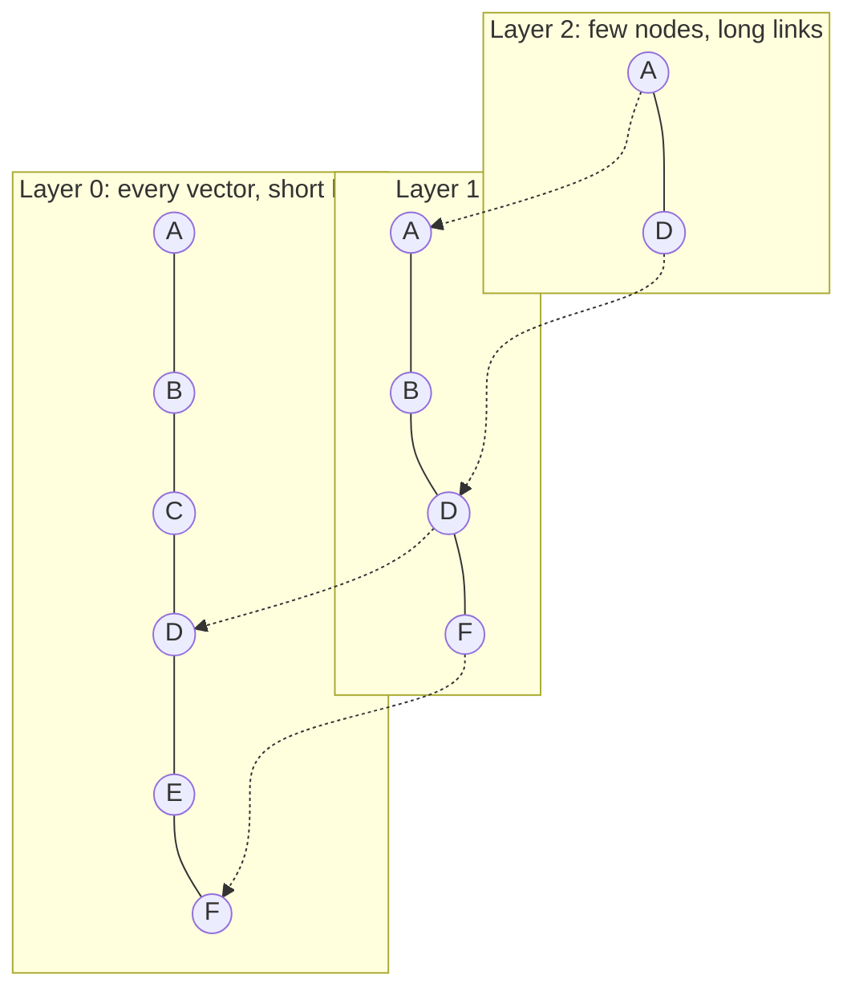

In session 9.3.1 you searched a few thousand vectors with one NumPy multiplication. That doesn't
scale to millions of vectors, many concurrent users, updates, filters and backups. A **vector
database** (or a vector extension to a normal database) stores embeddings and answers "give me
the k nearest vectors to this one" quickly. This session covers how that works and compares the
two options you are most likely to use: [pgvector](https://github.com/pgvector/pgvector) in
PostgreSQL and [Qdrant](https://qdrant.tech/documentation/), a dedicated vector database.

## Exact vs approximate nearest neighbour search

**k-nearest-neighbour (kNN) search**: given a query vector, find the k stored vectors closest to it.

**Exact search** compares the query with every stored vector. It always finds the true top k, and
it is simple, but the work grows linearly: 10 million vectors means 10 million distance
computations per query. Fine for thousands, painful for millions.

**Approximate nearest neighbour (ANN) search** uses an index to look at only a small, promising
part of the data. It is much faster but may miss some true neighbours. Analogy: finding the best
coffee near you. Exact search visits every café in the country. ANN looks only in your
neighbourhood and the next one; occasionally the best café was one street outside the search
area.

The trade-off is measured with **recall**: the fraction of the true top-k that the ANN search
returned. Recall 0.95 at k=10 means, on average, 9.5 of the real 10 nearest were found.

| | Exact | Approximate |
| --- | --- | --- |
| Result | always the true top k | usually most of it (recall < 1) |
| Speed at scale | slow, linear | fast, sub-linear |
| Index | none needed | needs building, memory, tuning |
| Good for | small data, evaluation ground truth, heavily filtered queries | large collections, low latency |

> [!TIP]
> Under about 100k vectors, exact search in pgvector is often fast enough. Add an ANN index when
> measurements say you need one, and use exact search as the "ground truth" to measure your ANN
> recall.

## Index types: HNSW, IVF

Two index families dominate.

**HNSW (Hierarchical Navigable Small World)** builds a graph where each vector is linked to some
of its neighbours, in several layers. The top layer has few nodes and long links (like motorways),
lower layers have more nodes and short links (like local streets). A search starts at the top,
greedily moves towards the query, drops down a layer, and repeats.



Key parameters (names from pgvector; Qdrant has equivalents):

- `m`: links per node. More links, better recall, more memory.
- `ef_construction`: how hard the builder searches when inserting. Higher = better graph, slower
  build.
- `ef_search` (query time): how many candidates to keep while searching. Higher = better recall,
  slower queries. This is the knob you tune most.

HNSW gives excellent speed and recall, can be built on an empty table and handles inserts, but uses
a lot of memory and builds slowly.

**IVF (inverted file)** first clusters the vectors (k-means) into `lists` buckets. A query finds the
closest cluster centres and searches only inside those buckets (`probes`). It builds faster and
uses less memory than HNSW, but its recall/speed trade-off is usually worse, and it should be built
**after** loading representative data, because the clusters are learned from it.

> [!NOTE]
> Large systems add **quantisation**: storing compressed vectors (for example 8-bit or binary
> instead of 32-bit floats) to cut memory, then re-scoring the top candidates with full vectors.
> Both pgvector and Qdrant support forms of it; reach for it when memory becomes the bottleneck.

## pgvector in PostgreSQL

[pgvector](https://github.com/pgvector/pgvector) adds a `vector` column type, distance operators
and ANN indexes to PostgreSQL. YouCanDoIt uses it: chunks and their 768-dimensional embeddings live
in the same database as the rest of the app, with an HNSW index.

```sql
CREATE EXTENSION IF NOT EXISTS vector;

CREATE TABLE chunks (
  id bigserial PRIMARY KEY,
  document_id bigint REFERENCES documents(id) ON DELETE CASCADE,
  text text NOT NULL,
  embedding vector(768) NOT NULL
);

-- HNSW index for cosine distance
CREATE INDEX ON chunks USING hnsw (embedding vector_cosine_ops);

-- 5 nearest chunks to a query vector
SELECT id, text, embedding <=> $1 AS distance
FROM chunks
ORDER BY embedding <=> $1
LIMIT 5;
```

The operators are `<->` (L2 distance), `<#>` (negative inner product) and `<=>` (cosine distance).
The index's operator class must match the operator you query with, otherwise PostgreSQL silently
does an exact scan. Check with `EXPLAIN`.

```sql
SET hnsw.ef_search = 100;   -- default 40; higher = better recall, slower
```

Why pgvector is often the right first choice:

- **One database**: vectors sit next to users, permissions and documents. Joins, transactions,
  backups and access control are things you already know.
- **Consistency**: delete a document and its chunks vanish in the same transaction.
- **SQL filters**: `WHERE tenant_id = $2 AND created_at > now() - interval '30 days'`.

Limits appear at very large scale (many tens of millions of vectors, very high query rates) or when
you need features dedicated engines optimise heavily, like advanced quantisation and distributed
sharding.

> [!TIP]
> In Python, the `pgvector` package adds SQLAlchemy types and helpers like
> `Chunk.embedding.cosine_distance(query_vector)`, which is what `apps/api/app/rag.py` uses.

## Dedicated vector databases: Qdrant

[Qdrant](https://qdrant.tech/documentation/) is an open-source database built only for vector
search. Its vocabulary:

- **Collection**: like a table, with a fixed vector size and distance metric.
- **Point**: one record: an `id`, a `vector` (or several named vectors) and a **payload** (JSON
  metadata).
- HNSW indexing by default, with quantisation options and support for sparse vectors (used for
  hybrid search, session 9.3.4).

```sh
docker run -p 6333:6333 qdrant/qdrant
pip install qdrant-client
```

```python
from qdrant_client import QdrantClient
from qdrant_client.models import Distance, PointStruct, VectorParams

client = QdrantClient(url="http://localhost:6333")
client.create_collection("notes", vectors_config=VectorParams(size=768, distance=Distance.COSINE))
client.upsert("notes", points=[
    PointStruct(id=i, vector=vec, payload={"file": f, "text": t}) for i, (vec, f, t) in enumerate(rows)
])
hits = client.query_points("notes", query=query_vector, limit=5).points
```

When a dedicated engine makes sense: vectors are the core of the product, the collection is very
large, you need heavy filtering at high throughput, or several services share one search layer.
The costs: another system to run, back up, secure and monitor, and data to keep in sync with your
main database.

## Metadata filtering

Real queries are rarely "nearest vectors in the whole collection". They are "nearest vectors **in
this user's documents**, **in English**, **from the last year**". Filtering is easy to get wrong:

- **Post-filtering**: get the top 10 by similarity, then drop those that fail the filter. If 9 of
  the 10 belong to other tenants, you return 1 result, or none.
- **Pre-filtering**: filter first, then search only the matching vectors. Correct, but the ANN
  index was built for the whole collection.

Engines handle this differently. Qdrant applies payload filters during the HNSW search and lets you
create **payload indexes** on filtered fields so it can plan efficiently. pgvector filters with
normal `WHERE` clauses; for selective filters it can help to add a B-tree index on the filter
column, use partial indexes or partitioning, or enable pgvector's **iterative index scans** so the
index keeps scanning until enough rows pass the filter (see the pgvector README for the settings in
your version).

```python
from qdrant_client.models import FieldCondition, Filter, MatchValue

hits = client.query_points(
    "notes", query=query_vector, limit=5,
    query_filter=Filter(must=[FieldCondition(key="user_id", match=MatchValue(value=42))]),
).points
```

> [!WARNING]
> In a multi-tenant app, the tenant filter is a **security control**, not a relevance tweak. A
> missing `WHERE tenant_id = ...` leaks one customer's documents into another's answers. Enforce it
> in one place (a repository function), and test it.

## Practice: the same search on pgvector and Qdrant, compared

Load the same embeddings into both and compare speed, recall and developer experience. About two
hours.

### Step 1: Prepare data

Reuse `index.json` from session 9.3.1, or embed a larger public dataset (10k-100k short texts) so
differences show up. Add a `category` field to each item for filtering.

### Step 2: Load pgvector

```sh
docker run -d --name pgv -e POSTGRES_PASSWORD=pw -p 5433:5432 pgvector/pgvector:pg17
```

Create the table with `vector(768)` and `category text`, bulk insert (use `COPY` or batched
inserts), and time the load. Then create the HNSW index and time that separately.

### Step 3: Load Qdrant

Start Qdrant in Docker, create a collection with the same size and cosine distance, upsert in
batches of 500, and create a payload index on `category`.

### Step 4: Measure

Pick 100 queries. For each system record:

- median and p95 query latency for top-10,
- recall@10 against exact search (in pgvector, run the same query with
  `SET enable_indexscan = off` to get ground truth),
- the same two numbers with a `category` filter that matches about 5% of the data.

### Step 5: Tune and decide

Raise `hnsw.ef_search` in pgvector (and `hnsw_ef` in Qdrant's search params) and see how recall and
latency move. Write a half-page decision note: for YouCanDoIt-sized data, which would you pick and
why? At what size or requirement would you switch?
