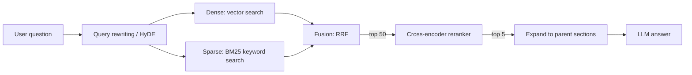

A basic RAG pipeline (session 9.3.3) gets you surprisingly far, and then stalls. Users search for
an error code and get vaguely related prose. A follow-up question retrieves nothing useful. The
right chunk is in the top 50 but not the top 5. Each technique in this session fixes one of those
failures. None is magic, each adds cost and complexity, so add them one at a time and **measure
the gain** (that is the practice, and the whole of session 9.3.5). References: the
[LlamaIndex docs](https://developers.llamaindex.ai/python/framework/), which implement most of
these as retrievers and postprocessors, and the [Qdrant docs](https://qdrant.tech/documentation/),
which cover hybrid queries and reranking at the database level.



## Hybrid search (BM25 + vectors)

Vector (dense) search is great at meaning and bad at exact strings. Ask for `ERR_CONN_RESET`,
`pg_stat_statements` or invoice "INV-2025-0042", and embeddings blur the identifier into "some
error", "some Postgres thing", "some invoice". Keyword search is the opposite: exact on terms, blind
to synonyms.

**BM25** is the classic keyword ranking function used by search engines. It scores a document
higher when it contains the query terms, more so for rare terms (a match on "pgvector" counts more
than a match on "the"), with diminishing returns for repeating a term and a correction for document
length. It is represented as a **sparse vector**: mostly zeros, one dimension per vocabulary word.

**Hybrid search** runs both and merges the results. The simplest robust way to merge is
**Reciprocal Rank Fusion (RRF)**: ignore the raw scores (they are on different scales) and add up
`1 / (k + rank)` for each list the document appears in, with k typically 60.

```python
def rrf(*rankings: list[str], k: int = 60) -> list[str]:
    scores: dict[str, float] = {}
    for ranking in rankings:
        for rank, doc_id in enumerate(ranking, start=1):
            scores[doc_id] = scores.get(doc_id, 0) + 1 / (k + rank)
    return sorted(scores, key=scores.get, reverse=True)

ids = rrf(vector_search(q, 50), keyword_search(q, 50))
```

Where to get the keyword side:

- **PostgreSQL full-text search** (`tsvector`, `ts_rank`) next to pgvector: not exactly BM25, but
  close enough to start, and it keeps everything in one database.
- **Qdrant** supports sparse vectors alongside dense ones and can fuse them in a single query.
- A search engine (Elasticsearch, OpenSearch) if you already run one.

> [!TIP]
> Hybrid search helps most when your content has identifiers, code, product names or jargon. If
> your users ask only natural-language questions about prose, the gain may be small. Measure.

## Reranking with cross-encoders

The embedding models you have used so far are **bi-encoders**: they embed the question and each
chunk *separately*, then compare vectors. That is fast (chunk vectors are computed once) but crude,
because the model never sees the question and the chunk together.

A **cross-encoder** takes the question and one chunk *together* as input and outputs a relevance
score. It can notice that the chunk mentions your exact error but in a different product, or
answers a slightly different question. Much more accurate, and much slower: one model call per
(question, chunk) pair, nothing precomputed.

So you combine them in two stages: retrieve broadly and cheaply, then rerank precisely.
Analogy: a recruiter screens 200 CVs by keywords in minutes (retrieval), then interviews the top 20
properly (reranking).

```python
from sentence_transformers import CrossEncoder

reranker = CrossEncoder("cross-encoder/ms-marco-MiniLM-L-6-v2")   # small, runs on CPU

candidates = hybrid_search(question, k=40)
scores = reranker.predict([(question, c.text) for c in candidates])
top = [c for _, c in sorted(zip(scores, candidates), key=lambda x: -x[0])][:5]
```

Options range from small open models like the one above (fine on CPU for a few dozen pairs), to
larger open rerankers, to hosted rerank APIs. LlamaIndex exposes them as **node postprocessors**
you add after a retriever.

> [!WARNING]
> Reranking adds latency per query: tens to hundreds of milliseconds depending on the model and the
> number of candidates. Keep the candidate list modest (20-50) and measure end-to-end latency, not
> just quality.

## Query rewriting and HyDE

Sometimes the problem is the question, not the index.

**Query rewriting** uses a cheap LLM call to turn the user's message into better search queries:

- **Conversational rewriting**: "and how do I fix it?" becomes "how to fix pgvector HNSW index
  build running out of memory" using the chat history. Essential for chatbots.
- **Multi-query**: generate three different phrasings and retrieve for each, then fuse with RRF.
  Helps when users phrase things unlike the documents.
- **Decomposition**: "compare pgvector and Qdrant filtering" becomes two queries, one per system.

```text
Given the conversation and the follow-up question, write a standalone search query
that contains all the needed context. Output only the query.

<conversation>{{HISTORY}}</conversation>
<question>{{QUESTION}}</question>
```

**HyDE (Hypothetical Document Embeddings)** flips the problem: questions and answers look
different, so embed an *answer-shaped* text instead. Ask the LLM to write a plausible (possibly
wrong) answer paragraph, embed that, and search with it. The fake answer uses the vocabulary and
style of real documents, so it lands closer to them in embedding space. The fake answer is never
shown to the user; only the real retrieved chunks are used.

> [!NOTE]
> Every rewriting technique adds an LLM call before retrieval, so it adds latency and cost to every
> question. Use a small fast model and consider applying it only when needed (for example only for
> follow-up turns).

## Contextual retrieval and parent-document strategies

Chunking creates a dilemma: small chunks retrieve precisely but lack context; big chunks have
context but retrieve poorly. Two families of fixes.

**Contextual retrieval**: before embedding, enrich each chunk with a short description of where it
sits in its document. The simplest version is prepending the title and heading path (session
9.3.3). A more powerful version asks an LLM, once per chunk at indexing time: "here is the whole
document and one chunk; write one or two sentences situating the chunk within the document". A
chunk saying "Revenue grew 3% over the previous quarter" becomes findable as "ACME Q2 2025 report:
revenue grew 3%...". Index the enriched text for both vector and keyword search. It costs LLM calls
at indexing time, which prompt caching of the shared document makes much cheaper.

**Parent-document (small-to-big) retrieval**: index small chunks for precise matching, but give the
LLM the larger unit they came from.

| Strategy | Retrieve on | Send to the LLM |
| --- | --- | --- |
| Parent document | small child chunks | the parent section or page |
| Sentence window | single sentences | the sentence plus N sentences around it |
| Auto-merging | small chunks | the parent, when several of its children are retrieved |

LlamaIndex implements these as node parsers and retrievers (for example sentence-window and
auto-merging retrieval). In your own pgvector schema it is a `parent_id` column and one extra query.

```sql
SELECT DISTINCT p.id, p.title, p.text
FROM chunks c JOIN sections p ON p.id = c.section_id
ORDER BY ... -- by the best child distance
LIMIT 4;
```

## Practice: measure the quality gain of reranking

Add a cross-encoder reranker to your document chatbot from 9.3.3 and prove (or disprove) that it
helps. About two hours.

### Step 1: Build a small labelled set

Write 30 questions about your documents. For each, record the ID of the chunk (or chunks) that
contains the answer. Include some with exact identifiers and some paraphrased.

### Step 2: Baseline

For each question, run your current vector search with k=5 and record whether a correct chunk
appears (hit) and at which rank. Compute **hit rate@5** and **MRR** (mean of `1/rank` of the first
correct chunk, 0 if missing). Session 9.3.5 formalises these metrics.

### Step 3: Add reranking

Retrieve 30 candidates with vector search, rerank with a cross-encoder, keep the top 5. Recompute
both metrics. Record the extra latency per query (median and p95).

### Step 4: Add hybrid search

Add PostgreSQL full-text search (a `tsvector` generated column with a GIN index), fuse with RRF,
then rerank. Recompute.

### Step 5: Report

| Pipeline | Hit rate@5 | MRR | Median latency |
| --- | --- | --- | --- |
| Vector only | | | |
| Vector + rerank | | | |
| Hybrid + rerank | | | |

Look at the questions that changed: which did reranking fix, which did it break? Decide whether the
gain is worth the latency for your chatbot, and write that decision down with the numbers.
