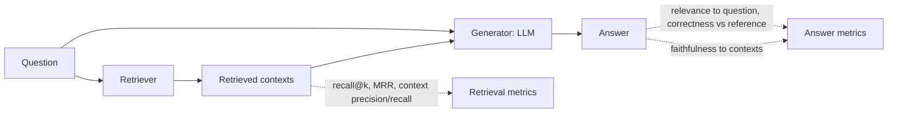

"The chatbot seems better" is not a measurement. RAG systems have many knobs (chunk size, k,
embedding model, reranker, prompt, LLM) and changing one can improve some questions while silently
breaking others. **Evaluation** turns "seems better" into numbers you can compare across versions.
This session splits the problem the way RAG is built, into **retrieval** quality and **answer**
quality, and shows how to build a dataset and use [Ragas](https://docs.ragas.io/) and
[Hugging Face Evaluate](https://huggingface.co/docs/evaluate/index) to score it.



## Retrieval metrics: recall@k, MRR

Retrieval metrics ask: **did the right chunks reach the LLM?** If they didn't, no prompt can save
the answer. To compute them you need, for each test question, the IDs of the relevant chunks (or
documents): your "ground truth".

**Recall@k**: of all relevant chunks for a question, what fraction is in the top k results?
Averaged over questions. If a question has 2 relevant chunks and your top 5 contains 1,
recall@5 = 0.5. When each question has exactly one relevant chunk this is often called **hit
rate@k**: 1 if found in the top k, else 0.

**MRR (Mean Reciprocal Rank)**: for each question take `1 / rank` of the *first* relevant result
(0 if none in the list), then average. Rank 1 scores 1, rank 2 scores 0.5, rank 5 scores 0.2. It
rewards putting the right chunk *first*, which matters because models pay more attention to some
positions and because you may only send the top few.

```python
def recall_at_k(retrieved: list[str], relevant: set[str], k: int) -> float:
    return len(set(retrieved[:k]) & relevant) / len(relevant)

def reciprocal_rank(retrieved: list[str], relevant: set[str]) -> float:
    for rank, doc_id in enumerate(retrieved, start=1):
        if doc_id in relevant:
            return 1 / rank
    return 0.0

recall5 = mean(recall_at_k(run(q), q.relevant, 5) for q in dataset)
mrr = mean(reciprocal_rank(run(q), q.relevant) for q in dataset)
```

Other metrics you will meet: **precision@k** (how much of the top k is relevant, measuring noise)
and **nDCG** (graded relevance with position discount). Recall@k and MRR are enough to start.

> [!TIP]
> Retrieval metrics are cheap, fast and deterministic: no LLM needed. Run them on every change to
> chunking, embedding model, hybrid search or reranking. They are the RAG equivalent of unit tests.

## Answer metrics: faithfulness, relevance

Good retrieval doesn't guarantee a good answer. Answer metrics ask two different questions:

**Faithfulness (groundedness)**: is every claim in the answer supported by the retrieved contexts?
An unfaithful answer adds facts that aren't in the sources: a hallucination, even if it happens to
be true. Measured by splitting the answer into claims and checking each claim against the contexts,
usually with an LLM.

**Answer relevance**: does the answer actually address the question? A perfectly faithful answer
that talks about something else is useless. One approach: generate the questions the answer would
be a good answer to, and compare them with the real question.

Two more are useful when you have reference answers:

- **Answer correctness / factual correctness**: does the answer agree with a reference answer
  written by a human?
- **Context precision and context recall** (Ragas names): are the relevant contexts ranked high,
  and do the retrieved contexts contain everything the reference answer needs? These are
  LLM-judged retrieval metrics that work even without chunk-ID labels.

| Failure | Faithfulness | Relevance |
| --- | --- | --- |
| Makes up a deprecation date not in the docs | low | high |
| Accurately quotes docs, but about the wrong feature | high | low |
| Says "not in my sources" when it isn't | high | lowish, but correct behaviour |

> [!NOTE]
> Classic text-overlap metrics like BLEU or ROUGE (available in
> [Hugging Face Evaluate](https://huggingface.co/docs/evaluate/index) via `evaluate.load("rouge")`)
> compare words with a reference. They are cheap but miss paraphrases and can reward fluent wrong
> answers. Fine for summaries against references, weak for RAG faithfulness. Evaluate also offers
> `exact_match` and embedding-based metrics like BERTScore.

## Building an evaluation dataset

The dataset is the most valuable part of an evaluation. Metrics are commodities; knowing what your
users ask and what a good answer is, is not.

Each item ideally has:

```json
{
  "question": "What does hnsw.ef_search control?",
  "relevant_chunk_ids": ["pgvector-readme#hnsw-query-options"],
  "reference_answer": "The size of the candidate list during HNSW search; higher improves recall but slows queries.",
  "tags": ["pgvector", "parameter", "single-hop"]
}
```

Where questions come from:

1. **Real user questions** from logs (anonymised): the best source.
2. **Hand-written** by someone who knows the documents: cover each important topic.
3. **Synthetic**: an LLM reads a chunk and writes a question it answers, with the chunk as ground
   truth. Ragas has test-set generation utilities for this. Fast and cheap, but questions tend to
   copy the chunk's wording, which flatters vector search. Review and edit them.

Cover the **types** of question your system faces: single-fact lookups, questions needing two
chunks (multi-hop), comparisons, questions with exact identifiers, conversational follow-ups,
and **unanswerable** questions where the right answer is "I don't know".

> [!WARNING]
> Keep the evaluation set fixed while you tune, and don't tune on every single example. If you
> rewrite the prompt until all 30 questions pass, you have overfitted to 30 questions. Hold out a
> second set you look at only occasionally.

Start with 30-50 items; grow towards a few hundred as the product matures. Version the dataset in
git like code.

## Ragas

[Ragas](https://docs.ragas.io/) is an open-source library of RAG and LLM-application metrics. You
give it, for each question, the user input, the retrieved contexts, the generated response and
(optionally) a reference, and it computes metrics, most of them using an LLM as the judge. The
getting-started guide builds an `EvaluationDataset` from records with `user_input`,
`retrieved_contexts`, `response` and `reference`, then calls `evaluate` with metric objects:

```python
from ragas import EvaluationDataset, evaluate
from ragas.metrics import Faithfulness, LLMContextRecall, FactualCorrectness

records = []
for item in dataset:
    contexts = [h.text for h in retrieve(item["question"])]
    records.append({
        "user_input": item["question"],
        "retrieved_contexts": contexts,
        "response": answer(item["question"], contexts),
        "reference": item["reference_answer"],
    })

result = evaluate(
    dataset=EvaluationDataset.from_list(records),
    metrics=[LLMContextRecall(), Faithfulness(), FactualCorrectness()],
    llm=evaluator_llm,   # a judge model wrapped as the Ragas docs describe
)
print(result)            # e.g. {'context_recall': ..., 'faithfulness': ..., 'factual_correctness': ...}
df = result.to_pandas()  # per-question scores: read the worst ones
```

Ragas' API evolves between versions; follow the docs for the version you install, especially for
how to wrap the judge LLM.

Treat LLM-judged scores with healthy scepticism:

- The judge can be wrong. Read a sample of per-question scores and check them by hand.
- Scores vary between runs and judge models. Compare versions with the **same** judge and dataset.
- The value is in the **per-question breakdown**, not the average: sort by lowest faithfulness and
  read those answers.

## Practice: evaluate your document chatbot

Evaluate the chatbot from 9.3.3 (with or without the reranker from 9.3.4). About three hours.

### Step 1: Build the dataset

Turn your notes from 9.3.3's practice into `eval/rag.jsonl` with 40 items: 25 from real or
hand-written questions, 10 synthetic ones you've reviewed, and 5 unanswerable ones. Label relevant
chunk IDs for the answerable ones and write short reference answers.

### Step 2: Retrieval report

Write `eval/retrieval.py` that prints recall@5, recall@10 and MRR, plus the questions with
reciprocal rank 0. No LLM calls needed.

### Step 3: Answer report

Run the full pipeline and score it with Ragas (faithfulness, context recall, factual correctness).
For the unanswerable questions, add a simple code check: did the answer say it couldn't find the
information?

### Step 4: Read the worst five

For the five lowest-scoring answers, decide which stage failed: extraction, chunking, retrieval,
prompt or model. Write it next to each one.

### Step 5: Change one thing and compare

Change one variable (chunk size, k, reranker on/off, prompt wording). Re-run both reports and
put the results side by side. Commit the dataset, scripts and a short `eval/RESULTS.md` table so the
next change can be compared with this one.
