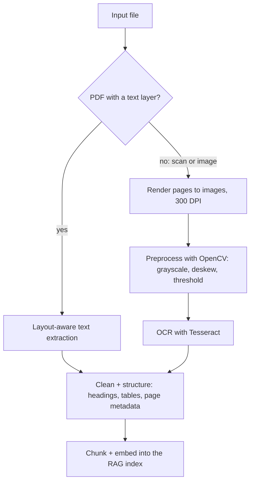

A lot of the world's important information is locked in documents that aren't really text: scanned
contracts, photographed receipts, faxed forms, PDFs exported from slides. Your RAG pipeline from
Module 9.3 can only search text it can read. This session covers getting text, and as much
structure as possible, out of those documents: **OCR** for images, **layout-aware extraction** for
PDFs, and the cleaning that makes the result usable. References: the
[Tesseract docs](https://tesseract-ocr.github.io/tessdoc/) and the
[OpenCV tutorials](https://docs.opencv.org/4.x/d9/df8/tutorial_root.html) for image preprocessing.



## OCR with Tesseract

**OCR (optical character recognition)** turns pixels into characters. Analogy: a very fast typist
copying a photocopy. Good copy, good transcript; smudged, skewed or tiny copy, many typos.

[Tesseract](https://tesseract-ocr.github.io/tessdoc/) is the best-known open-source OCR engine.
Modern versions use a neural network (LSTM) line recogniser, support over a hundred languages via
downloadable language data, and run comfortably on a CPU.

```sh
# macOS: brew install tesseract tesseract-lang   |  Debian/Ubuntu: apt install tesseract-ocr tesseract-ocr-ita
tesseract receipt.png stdout -l eng+ita --psm 6
```

Options you will actually use:

- **`-l`**: languages, combinable (`eng+ita`). The wrong language hurts accuracy, especially for
  accented characters.
- **`--psm`** (page segmentation mode): how Tesseract assumes the page is laid out. The default
  handles a full page automatically; `6` assumes a single uniform block of text; `7` a single line;
  `11` sparse text in no particular order (useful for receipts and screenshots). Trying two or three
  modes on a bad document is often the cheapest fix.
- **Output formats**: plain text, or **hOCR / TSV** with each word's bounding box and confidence.

From Python, `pytesseract` wraps the binary:

```python
import pytesseract
from PIL import Image

img = Image.open("receipt.png")
text = pytesseract.image_to_string(img, lang="eng", config="--psm 6")

data = pytesseract.image_to_data(img, output_type=pytesseract.Output.DICT)
low = [w for w, c in zip(data["text"], data["conf"]) if w.strip() and float(c) < 60]
print(f"{len(low)} low-confidence words")   # flag pages for review
```

Word-level **confidence** is valuable: route pages with many low-confidence words to a human or to
a vision LLM (session 9.4.2) instead of indexing garbage.

**Preprocessing** often matters more than the OCR engine. The Tesseract docs' page on improving
output quality recommends, among other things, enough resolution (around 300 DPI), binarisation,
noise removal and deskewing. OpenCV does all of these:

```python
import cv2

img = cv2.imread("scan.jpg")
gray = cv2.cvtColor(img, cv2.COLOR_BGR2GRAY)
gray = cv2.medianBlur(gray, 3)                                     # remove speckle noise
_, bw = cv2.threshold(gray, 0, 255, cv2.THRESH_BINARY + cv2.THRESH_OTSU)  # black text on white
cv2.imwrite("clean.png", bw)
```

> [!TIP]
> If text is small in the image, upscale it (for example with `cv2.resize` and `INTER_CUBIC`)
> before OCR. Tesseract struggles when capital letters are only a few pixels tall.

> [!WARNING]
> Tesseract reads printed text. Handwriting, complex tables, stamps over text and very low-quality
> photos will produce poor results. Know where the tool stops, and measure on your real documents
> rather than on a clean sample.

## Layout-aware extraction from PDFs

A PDF is not a document format in the Word sense; it is a set of drawing instructions: "put these
glyphs at these coordinates". There may be no notion of paragraphs, columns, reading order or
tables at all. Two very different cases:

1. **Born-digital PDFs** (exported from Word, LaTeX, a browser) have a **text layer**. You can
   extract text directly, quickly and accurately, without OCR.
2. **Scanned PDFs** are images wrapped in a PDF. There is no text layer; you must OCR.

Check which you have first: if a library returns almost no text for a page, it is probably a scan.

Naive extraction of born-digital PDFs still causes problems: two-column layouts interleave lines
from both columns, headers and footers repeat on every page, hyphenated words split across lines,
and tables come out as streams of numbers. **Layout-aware** tools use the coordinates to rebuild
structure:

| Tool | Good at |
| --- | --- |
| `pdfplumber` | Words with positions, cropping regions, table extraction |
| PyMuPDF (`fitz`) | Fast text extraction by blocks, with font sizes (to spot headings) |
| OCRmyPDF | Adds a Tesseract text layer to scanned PDFs, so normal tools work afterwards |
| Layout models / document AI services | Detecting titles, tables, figures and reading order with ML |

```python
import pdfplumber

with pdfplumber.open("report.pdf") as pdf:
    for page in pdf.pages:
        body = page.crop((0, 50, page.width, page.height - 50))   # drop header/footer bands
        text = body.extract_text()
        tables = body.extract_tables()
```

> [!NOTE]
> Font size and weight are a cheap heading detector: in many reports, any line noticeably larger
> than the median font size is a heading. Keeping headings is what lets you chunk by section and
> prefix chunks with their heading path (session 9.3.3).

## Cleaning and structuring extracted text

Raw extracted text needs a cleaning pass before it is worth embedding. Typical steps:

- **Normalise whitespace and Unicode**: collapse repeated spaces, fix ligatures (`fi` to `fi`),
  normalise quotes with `unicodedata.normalize("NFKC", text)`.
- **Re-join hyphenated line breaks**: `inter-\nnational` becomes `international`.
- **Merge lines into paragraphs**: a line break inside a sentence is usually a layout artefact.
- **Remove repeated headers, footers and page numbers**: lines that appear on most pages.
- **Fix common OCR confusions** carefully and only where context is clear (`0`/`O`, `1`/`l`), for
  example inside known patterns like invoice numbers.
- **Keep structure**: output Markdown with `#` headings and tables, plus metadata like source file
  and page number per section, so citations can say "page 7".

```python
import re, unicodedata

def clean(text: str) -> str:
    text = unicodedata.normalize("NFKC", text)
    text = re.sub(r"(\w)-\n(\w)", r"\1\2", text)          # de-hyphenate
    text = re.sub(r"(?<![.\n:])\n(?!\n)", " ", text)       # join wrapped lines
    text = re.sub(r"[ \t]+", " ", text)
    return text.strip()
```

For documents with known structure (invoices, forms, IDs), go further: extract fields into a
schema with an LLM and validate them, exactly as in the invoice practice of session 9.1.4. OCR gives
you text; structured extraction gives you data.

> [!WARNING]
> Scanned documents are often the sensitive ones: contracts, IDs, medical forms. Decide where OCR
> runs (local Tesseract keeps data on your machine; a cloud API doesn't), and what you store.
> GDPR's data minimisation (session 6.5.1) applies here.

## Practice: OCR pipeline feeding your RAG index

Extend the ingestion of your document chatbot (9.3.3) to handle scanned PDFs and images. About
three hours.

### Step 1: Gather test documents

Collect about ten files: two born-digital PDFs (one two-column), three scanned PDFs, three phone
photos of printed pages, and two images with mixed text (a receipt, a slide screenshot). Remove
personal data.

### Step 2: Detect and route

Write `extract(path) -> list[Page]` that for PDFs tries the text layer per page with `pdfplumber`
and falls back to OCR when a page yields fewer than about 20 words; images always go to OCR. Each
`Page` keeps `source`, `page_number`, `text`, `method` ("text-layer" or "ocr") and a mean confidence
for OCR pages.

### Step 3: OCR with preprocessing

Render scanned pages to 300-DPI images (`pdftoppm -r 300` or PyMuPDF), preprocess with OpenCV
(grayscale, denoise, Otsu threshold) and run Tesseract with the right languages. Compare the
character output with and without preprocessing on two bad photos.

### Step 4: Clean, chunk and index

Apply your cleaning function, keep page numbers in chunk metadata, and send everything through your
existing chunk-embed-store code. Skip (and log) pages with mean confidence under 60.

### Step 5: Check it end to end

Ask the chatbot five questions whose answers are only in the scanned documents, and check the
citations point to the right file and page. Note which failures came from OCR quality; you'll
compare against a vision LLM in the next session.
