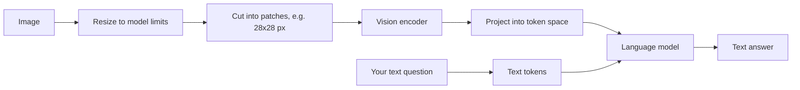

Session 9.4.1 extracted text from images with a specialised tool. **Multimodal LLMs** take a
different approach: you give the model the image itself and ask questions about it in plain
language. "What's the total on this receipt?", "Which month had the highest churn in this chart?",
"What error is shown in this screenshot?" This session explains how vision models process images,
how to send images and PDFs through the APIs, and where they shine and fail. References: the
[Claude vision docs](https://platform.claude.com/docs/en/build-with-claude/vision) and the
[OpenAI API docs](https://developers.openai.com/api/docs).

## How vision models see images

A language model works on tokens. To let it "see", the image is turned into tokens too:

1. The image is resized to fit the model's limits and cut into a grid of small square **patches**.
2. A **vision encoder** (a transformer trained on images, often together with captions) turns each
   patch into a vector.
3. A projection layer maps those vectors into the same space as text token embeddings, so the
   language model can attend to image patches and words together.

Analogy: a tourist who doesn't read the local alphabet, given a photo cut into tiles with a
translator describing each tile in their language. The model then reasons over the described tiles
together with your question.



Practical consequences:

- **Images cost tokens.** The [Claude vision docs](https://platform.claude.com/docs/en/build-with-claude/vision)
  describe images as 28x28-pixel patches, each a visual token, so a 1000x1000 image costs about
  1,300 tokens. Images over the model's resolution limit are downscaled, which caps the cost.
- **Resolution limits what it can read.** If a big image is downscaled, small text can become
  illegible. Crop to the region that matters instead of sending a whole 4K screenshot.
- **The model does not run OCR.** It recognises text visually, which is why it handles messy
  layouts well but can occasionally misread digits, especially in low-quality or tiny images.

## Image and PDF inputs in LLM APIs

Images are just another **content block** in a user message. With Claude you can send them as
base64 data, as a URL, or as a `file_id` from the Files API (upload once, reuse many times):

```python
import anthropic, base64

client = anthropic.Anthropic()
data = base64.standard_b64encode(open("chart.png", "rb").read()).decode()

msg = client.messages.create(
    model="claude-sonnet-5-5",
    max_tokens=800,
    messages=[{
        "role": "user",
        "content": [
            {"type": "image", "source": {"type": "base64", "media_type": "image/png", "data": data}},
            {"type": "text", "text": "Which month had the highest value? Answer with month and value."},
        ],
    }],
)
```

Facts from the docs worth remembering:

- Supported formats are JPEG, PNG, GIF (first frame only) and WebP.
- Many images can go in one request (the docs list per-request limits), but request size limits
  can hit first; use the Files API for many or large images.
- With several images, label them in text ("Image 1:", "Image 2:") so you and the model can refer
  to them.
- Claude works best when **images come before the text** that asks about them, the same advice as
  for long documents.

**PDFs** can be sent as a `document` block. The model gets both the extracted text and an image of
each page, so it can use charts and layout as well as the words:

```python
pdf = base64.standard_b64encode(open("report.pdf", "rb").read()).decode()
content = [
    {"type": "document", "source": {"type": "base64", "media_type": "application/pdf", "data": pdf}},
    {"type": "text", "text": "Summarise the revenue table on page 3 as JSON."},
]
```

OpenAI's Responses API accepts images and files as input items in a similar way (`input_image`,
`input_file`); check the docs for the current field names.

> [!TIP]
> Combine vision with structured outputs (session 9.1.4): send the image plus a Pydantic schema and
> get validated data back. That is the core of most "extract data from screenshots" features.

> [!WARNING]
> Images in a multi-turn conversation are resent with the history on every turn (unless you use
> file references), multiplying tokens and latency. Summarise what you learned from an image into
> text and drop the image from later turns when you can.

## Use cases and limits

Where multimodal models work well:

| Use case | Example |
| --- | --- |
| Document understanding | Invoices, forms, receipts with irregular layouts that defeat template-based OCR |
| Charts and diagrams | Reading values from a bar chart, explaining an architecture diagram |
| Screenshots | Turning a bug-report screenshot into a description, extracting a table from a dashboard |
| UI work | Comparing a design mock with the implemented page, describing accessibility issues |
| Accessibility | Drafting alt text for images (with human review) |
| Agents | Computer and browser use, where the model sees screenshots and decides where to click |

The vision docs list limitations you must design around:

- **Accuracy** drops on low-quality, rotated or very small images. The model may **hallucinate**
  plausible values that aren't in the image, which is worse than OCR's obvious garbage because it
  looks right.
- **Spatial reasoning and precise coordinates** are approximate.
- **Counting** many small objects is approximate.
- It **cannot identify people** by name, and it can't tell whether an image is AI-generated.
- It is **not a medical device**: no diagnostic interpretation of scans.

| | Tesseract OCR (9.4.1) | Vision LLM |
| --- | --- | --- |
| Cost | free, local | per image tokens |
| Speed | fast on CPU | seconds per image |
| Messy layouts, charts | poor | good |
| Failure mode | visible garbage, low confidence | confident, plausible mistakes |
| Data leaves your machine | no | yes (hosted) |
| Determinism | high | lower |

> [!TIP]
> A common production pattern combines both: OCR first because it is cheap, then send pages with
> low OCR confidence, or fields that fail validation, to a vision LLM. And validate numbers in code:
> line items must add up to the total whatever read them.

## Practice: extract data from screenshots and charts

Build an extractor that reads values from chart images and dashboard screenshots, and measure how
accurate it is. About two hours.

### Step 1: Create a test set where you know the answers

Generate five bar or line charts with matplotlib from data you control, so you have ground truth.
Vary them: one with many bars, one with small labels, one with two series, one rotated 90 degrees,
one saved as a low-quality JPEG. Add three real screenshots (an analytics dashboard, a table in a
web page, a terminal error) and write their expected values by hand.

```python
import matplotlib.pyplot as plt, json
data = {"Jan": 120, "Feb": 95, "Mar": 143, "Apr": 160, "May": 88}
plt.bar(data.keys(), data.values()); plt.title("Signups"); plt.savefig("charts/signups.png", dpi=120)
json.dump(data, open("charts/signups.expected.json", "w"))
```

### Step 2: Define the schema

```python
class Series(BaseModel):
    name: str
    points: dict[str, float]   # label -> value

class ChartData(BaseModel):
    title: str | None
    series: list[Series]
    unreadable_labels: list[str] = []   # let the model say what it can't read
```

### Step 3: Extract

Send each image (before the text) with the instruction "Extract every data point. If a value is not
clearly readable, add its label to unreadable_labels instead of guessing." Use structured outputs
to get a `ChartData`.

### Step 4: Score

For each chart compute the share of values within 2% of the truth and list any invented labels.
Note the token usage per image; then downscale each image by half and re-run to see the cost and
accuracy trade-off.

### Step 5: Compare with OCR

Run Tesseract on the same images. Where does each approach fail? Write down a rule for when you'd
use OCR, a vision model, or both, for a feature in your own app.
