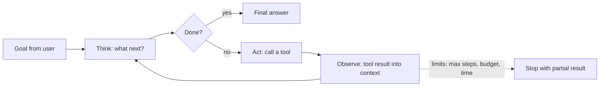
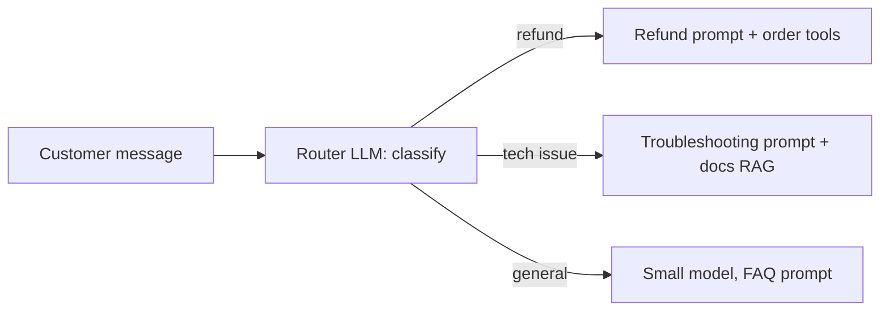
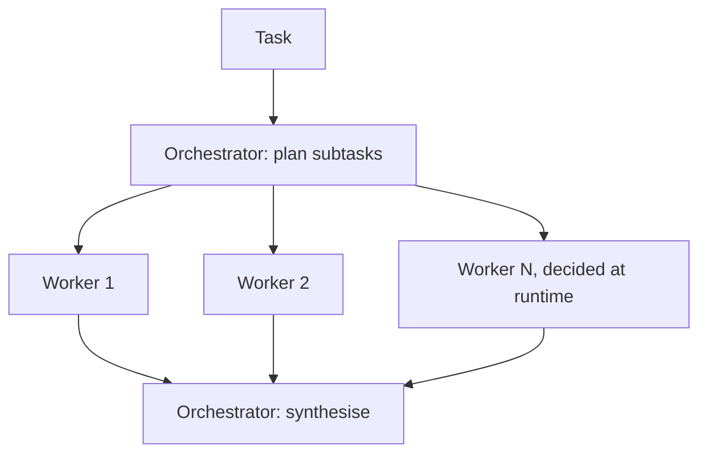
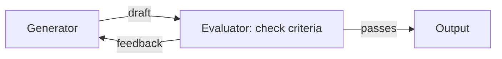

"Agent" is one of the most overloaded words in software right now. It gets applied to everything
from a single prompt with a fancy name to systems that write and deploy code for hours. This
session gives you precise vocabulary and, more importantly, judgement: when an agent is the right
design and when a simpler workflow is better. The main references are Anthropic's
[Building effective agents](https://www.anthropic.com/engineering/building-effective-agents),
which this session follows closely, and the
[Hugging Face Agents Course](https://huggingface.co/learn/agents-course).

## Workflows vs agents

Anthropic's article draws a useful line between two kinds of **agentic systems**:

- **Workflows**: LLMs and tools are orchestrated through **predefined code paths**. Your code
  decides the steps; the model fills them in. Example: classify the ticket, then (in code) send it
  to one of three prompts, then validate.
- **Agents**: the LLM **dynamically directs its own process and tool usage**, deciding what to do
  next based on what it observes, until it judges the task done.

Analogy: a workflow is a recipe card; each step is written down and the cook follows it. An agent is
a chef told "make dinner for six with what's in the fridge": they look, decide, taste, adjust.

Both are built from the same basic unit, which the article calls the **augmented LLM**: a model
enhanced with **retrieval** (session 9.3), **tools** (session 9.1.4) and **memory** (session
9.4.3).

| | Workflow | Agent |
| --- | --- | --- |
| Who decides the next step | your code | the model |
| Predictability | high | lower |
| Cost and latency | bounded, known | variable, can be large |
| Debugging | step by step | read the whole trajectory |
| Best for | well-defined tasks with known steps | open-ended tasks where steps can't be predicted |

## The agent loop: think, act, observe

At its core, an agent is a loop. The Hugging Face Agents Course describes it as a cycle of
**Thought, Action, Observation**:

1. **Think**: given the goal and everything so far, decide what to do next.
2. **Act**: call a tool (search, run code, read a file, call an API) with specific arguments.
3. **Observe**: receive the tool's result and add it to the context.
4. Repeat until the model decides the goal is reached (or a limit stops it).

This pattern is often called **ReAct** (reasoning + acting).

In API terms (session 9.5.2 builds it), this is exactly the tool-calling loop from 9.1.4 repeated:
send messages and tools, the model responds with `tool_use`, you execute and append a
`tool_result`, send again, until the model answers without calling a tool.

Two ingredients make agents work in practice, according to the Anthropic article:

- **Ground truth from the environment at each step**: test results, command output, search
  results. An agent that can check its work (run the tests) is far more reliable than one that
  only reasons.
- **Good tools**, designed with as much care as a human interface. The article calls this the
  **agent-computer interface (ACI)**: clear names and descriptions, examples, formats that are
  natural for the model, and designs that make mistakes hard (for example requiring absolute file
  paths instead of relative ones).

## Common agent patterns (routing, orchestrator–workers, evaluator–optimiser)

The article catalogues building blocks, from simple workflows to full agents. You have already met
**prompt chaining** (session 9.2.2). Three more patterns from this session's title, plus one
related:

**Routing**: classify the input, then send it to a specialised prompt, tool set or model. Lets each
path be optimised separately, and lets cheap models handle easy cases.

**Parallelisation**: run LLM calls simultaneously and aggregate. Two variants: **sectioning**
(split a task into independent parts, like reviewing a PR for security, performance and style in
parallel) and **voting** (run the same task several times and combine, like self-consistency in
9.2.2).

**Orchestrator–workers**: a central LLM breaks the task into subtasks **dynamically** (it decides
which and how many), delegates them to worker LLMs, and synthesises the results. Unlike
parallelisation, the subtasks aren't known in advance. Example: a coding change that touches an
unknown number of files.

**Evaluator–optimiser**: one LLM generates, another evaluates against criteria and gives feedback,
in a loop until the evaluation passes. Works when there are clear criteria and when feedback
demonstrably improves results, like a human editor's notes. Example: translation with nuance, or
search that needs several rounds.

Then there are fully **autonomous agents**: the loop from the previous section, running until
done, with the model choosing among tools at each step.

> [!TIP]
> These patterns compose. A real system might route first, then use orchestrator–workers for complex
> requests, with an evaluator–optimiser loop on the final answer. Start with one and add the next
> only when measurements show it helps.

## When not to build an agent

The article's central advice is to find the **simplest solution possible** and add complexity
only when needed, which often means not building an agentic system at all. A single LLM call with
retrieval and good examples is enough for many applications.

Signs an agent is the wrong tool:

- **The steps are known.** If you can draw the flowchart, write a workflow. It is cheaper, faster
  and testable.
- **Errors are expensive and hard to detect.** Agents trade predictability for flexibility, and
  errors can compound across steps. Moving money or deleting data without checkpoints is a bad fit.
- **Latency matters.** A loop of ten model calls and tool calls can take a minute.
- **There is no feedback signal.** If the agent can't check its progress (no tests, no observable
  result), it will confidently wander.
- **Cost must be predictable.** Agent runs vary widely in token usage.

Signs an agent fits: open-ended problems where the number of steps can't be predicted, a trusted
environment, clear success criteria, tools that give real feedback, and room for human review.
Coding agents are the canonical example: tests provide ground truth, version control makes changes
reversible, and a human reviews the result.

> [!WARNING]
> Frameworks make it easy to build agents quickly, but the article warns that extra layers of
> abstraction can obscure the underlying prompts and responses, making them harder to debug. Make
> sure you understand what the framework sends to the model. That is why session 9.5.2 builds an
> agent with no framework at all.

> [!EXAMPLE]
> A team wants an "agent" to triage bug reports. In practice the steps are always: extract fields,
> look up similar issues, assign a label and owner. That is a three-step workflow with routing, done
> in a day, costing a fraction of a cent per ticket. An agent would add variability and nothing
> else.

## Practice: diagram three agent patterns with examples

Make the patterns concrete by designing, not coding. About 75 minutes.

### Step 1: Pick three real problems

Choose one problem for each pattern from your own life or projects. For example:

- **Routing**: questions sent to the YouCanDoIt tutor (concept question, code-debugging question,
  "what should I study next?").
- **Orchestrator–workers**: "update all lessons that mention a deprecated API".
- **Evaluator–optimiser**: writing a cover letter that must hit five specific criteria.

### Step 2: Draw each one as a Mermaid diagram

For each, draw the flow with every LLM call, tool and decision point labelled. Annotate each LLM
call with the model tier you would use (small, middle, large) and why.

### Step 3: Write the contract for each box

For every LLM call write: input, output (format), tools available, and the stopping condition. For
the evaluator, write the actual criteria it checks.

### Step 4: Estimate cost and latency

Estimate tokens and number of calls for a typical run and a worst-case run. Use the price table from
your 9.1.1 script.

### Step 5: Challenge your own design

For each design answer: could this be a single prompt? a fixed workflow? What breaks if a step
fails, and how would you notice? Rewrite any design where the honest answer is "a simpler version
would do". Keep the best diagram; you will implement an agent in the next session.
