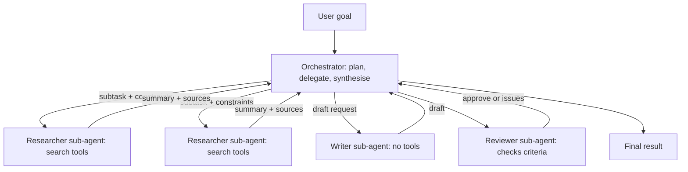

One agent with a long list of tools and a giant context eventually hits limits: the context fills
with irrelevant detail, the instructions try to cover every role at once, and nothing runs in
parallel. **Multi-agent systems** split the work among several agents, each with a focused role,
its own context and its own tools, coordinated by code or by another agent. They can solve bigger
problems, and they can also multiply your cost and your failure modes. This session is about
designing them deliberately. References: the
[Hugging Face Agents Course](https://huggingface.co/learn/agents-course), Anthropic's
[Building effective agents](https://www.anthropic.com/engineering/building-effective-agents), and
GitHub's [Agentic engineering system](https://github.com/resources/insights/agentic-engineering-system).

Analogy: a newsroom. An editor assigns stories, reporters research in parallel, a fact-checker
reviews, the editor assembles the edition. Nobody holds every detail of every story in their head;
the editor holds the plan.

## Orchestrator and sub-agents

The most common and most robust shape is the **orchestrator–workers** pattern from session 9.5.1,
with workers that are themselves agents (**sub-agents**):

- The **orchestrator** (or lead agent) understands the goal, makes a plan, delegates subtasks,
  and synthesises results.
- Each **sub-agent** gets a focused task, a clean context window, a role-specific prompt and only
  the tools it needs. It returns a **condensed** result, not its whole transcript.



Why this helps:

- **Context isolation**: a researcher can read 30 pages; only its 300-word summary reaches the
  orchestrator. The lead's context stays clean.
- **Specialisation**: each prompt and tool set is small and sharp, which improves reliability.
- **Parallelism**: independent subtasks run at the same time.
- **Least privilege**: only the agent that needs `write_file` gets it.

GitHub's agentic engineering material describes three **modes** of participation in any agentic
system: **director** (sets intent and constraints), **performer** (does the work) and **assessor**
(evaluates results). Agents fit best as performers on clear, low-risk, well-bounded tasks, can act
as assessors (summarising diffs, running checks), and should direct only within pre-authorised
limits. People keep direction and judgement for ambiguous or high-impact work.

> [!TIP]
> Write delegation messages like good tickets: objective, context the sub-agent needs, constraints,
> expected output format, and when to stop. Vague delegation ("research X") produces duplicated and
> unfocused work.

## Communication and shared state

Agents coordinate through one of a few mechanisms.

| Mechanism | How | Good for | Risk |
| --- | --- | --- | --- |
| **Message passing** (call and return) | orchestrator sends a task, gets a result | most systems | lead becomes a bottleneck |
| **Shared state** (blackboard) | agents read and write a common state object or store | pipelines, graphs | conflicting writes, unclear ownership |
| **Handoffs** | one agent transfers the conversation to another | routing to specialists | context lost in the transfer |
| **Artifacts** | agents write files, branches, PRs, documents; others read them | coding, long tasks | stale or partial artifacts |

Rules that keep shared state sane:

- **Typed, explicit state.** Define what the state contains (`plan`, `findings`, `draft`,
  `review`) as a schema, not a free-form chat log.
- **Single writer per field.** The researcher owns `findings`; the reviewer owns `review`.
- **Pass references, not blobs.** "The draft is in `out/draft.md`" beats pasting 5,000 tokens into
  every message.
- **Persist after each step** so a crash or a human pause can resume, and so you can replay runs.

> [!WARNING]
> Each hop is a lossy summary. Detail that the researcher saw but didn't write down is gone. When
> the final answer is wrong, the cause is often a summary two steps earlier. Ask sub-agents to
> include sources and uncertainties in their returns, not just conclusions.

## Frameworks overview (LangGraph, OpenAI Agents SDK, Claude Agent SDK)

You can build all of this with the plain loop from 9.5.2. Frameworks add structure, persistence,
tracing and integrations. The Hugging Face Agents Course has units on several frameworks
(smolagents, LlamaIndex and LangGraph) if you want guided practice.

| | LangGraph | OpenAI Agents SDK | Claude Agent SDK |
| --- | --- | --- | --- |
| Core idea | a graph of nodes over a shared typed state | agents with instructions and tools, plus handoffs between them | the agent harness behind Claude Code, as a library |
| Coordination | edges and conditional routing you define | handoffs and agents-as-tools | sub-agents, tools, MCP servers |
| Strengths | explicit control flow, checkpointing, human-in-the-loop interrupts | small API, built-in guardrails and tracing | file, shell and web tools, context management, permissions, hooks out of the box |
| Model support | many providers | OpenAI-first, others via adapters | Claude |

How to choose:

- Need **explicit, auditable control flow** (a workflow with some agentic steps)? A graph
  framework like LangGraph fits.
- Need **conversational agents that hand off** between specialists? Handoff-based SDKs fit.
- Need an **autonomous agent that works on files and code** with permissions and sub-agents?
  An agent harness like the Claude Agent SDK gives you that without rebuilding it.
- Small or very custom system? Your own loop may be clearer than any framework.

> [!NOTE]
> Frameworks change fast. Learn the concepts (state, nodes, handoffs, sub-agents, checkpoints,
> traces), then read the current docs of the one you pick. Building effective agents' warning
> applies: make sure you can see the actual prompts and tool calls the framework sends.

## Cost and failure modes

Multi-agent systems are expensive by construction: every agent has its own system prompt, its own
context and its own loop, so token usage can be many times that of a single agent on the same task.
They pay off when the task is valuable, parallelisable and too big for one context. They are waste
for tasks one agent or a workflow handles.

Failure modes to design against:

| Failure | What it looks like | Mitigation |
| --- | --- | --- |
| Duplicated work | two researchers search the same thing | precise, non-overlapping delegation |
| Endless loops | reviewer rejects, writer revises, forever | max rounds, then escalate to a human |
| Telephone game | facts distorted through summaries | sources in every handoff, final check against sources |
| Runaway spawning | the orchestrator creates 40 sub-agents | caps on sub-agents and total budget |
| Responsibility gaps | nobody checked the claim | explicit assessor role, criteria in writing |
| Cascading errors | a bad plan makes every step wrong | review the plan before execution (human or reviewer) |
| Silent cost growth | a run costs 10x the estimate | per-run budget, alerts, traces (9.5.5, 9.6.2) |

GitHub's guidance adds an organisational angle: expand agent use only as fast as governance and
shared knowledge can support it, start with one well-bounded workflow, track escaped defects and
rework alongside speed, and don't review agent output more lightly than comparable human work.

## Practice: a planner–executor–reviewer system

Build a three-role system with your own loop from 9.5.2 (or one framework, if you prefer) that
produces a short technical explainer. About three hours.

### Step 1: Define roles and state

```python
class RunState(BaseModel):
    goal: str
    plan: list[str] = []            # owned by planner
    findings: dict[str, str] = {}   # owned by executor: step -> result with sources
    draft: str = ""                 # owned by executor
    review: list[str] = []          # owned by reviewer: issues found
    round: int = 0
```

- **Planner**: no tools. Turns the goal into three to five concrete steps.
- **Executor**: `web_search` and `calculator` from 9.5.2. Runs each step, records findings with
  URLs, then writes a 400-word draft.
- **Reviewer**: no tools. Checks the draft against written criteria: every factual claim has a
  source from findings, the plan's steps are all covered, under 450 words, correct for a junior
  reader. Returns `approve` or a list of issues.

### Step 2: Orchestrate in code

Planner once, executor per step (in parallel where steps are independent), executor drafts,
reviewer reviews. If issues, executor revises with the issue list. Stop after approval or three
review rounds; then flag for a human.

### Step 3: Guardrails

Set a total token budget per run, a cap on executor steps, and save `RunState` to JSON after every
step.

### Step 4: Run five goals and measure

For each run record: total tokens and cost per role, number of review rounds, wall-clock time, and
your own 1-5 rating of the final explainer.

### Step 5: Compare with a single agent

Give the same five goals to your single research agent from 9.5.2 with the reviewer's criteria in
its prompt. Compare quality, cost and time. Write a short conclusion: for which goals did the
multi-agent version earn its extra cost?
