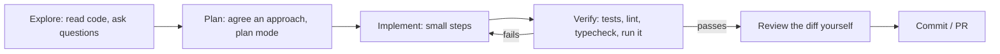

Claude Code is an agentic coding tool: the agent loop from 9.5.2, with file, shell and web tools,
permissions and sandboxing from 9.5.5, sub-agents from 9.5.4 and MCP from 9.5.3, packaged for your
terminal, IDE, desktop and browser. It is also the tool that wrote much of this platform, including
these lessons, through the `lesson-writer` sub-agent in `.claude/agents/`. Used well, it is a very
fast pair programmer; used carelessly, it produces confident changes you don't understand. This
session is about using it well. The reference throughout is the
[Claude Code docs](https://code.claude.com/docs/en/overview); MCP background is at
[modelcontextprotocol.io](https://modelcontextprotocol.io/).

## Claude Code workflows: plan, edit, test

Start it in a project directory:

```sh
cd your-project
claude                      # interactive session
claude "explain how lessons are validated against ROADMAP.md"   # start with a prompt
```

The most reliable workflow mirrors how a senior engineer works: **explore, plan, implement,
verify, commit**.



- **Explore first.** Ask it to read the relevant files and explain them before changing anything.
  You learn the codebase and it builds context.
- **Plan before editing** for anything non-trivial. **Plan mode** (cycle modes with Shift+Tab, or
  start with `--permission-mode plan`) lets Claude research and propose without editing. Push back
  on the plan; it is much cheaper to fix a plan than a diff.
- **Give it a way to verify.** Tests, a type checker, a linter, a script that reproduces the bug,
  or a screenshot to compare against. An agent that can run checks iterates to a working result;
  one that can't just stops when the code looks plausible.
- **Be specific.** "Fix the bug" is weak; "`test_lessons.py` fails for 9.3.2 because headings
  don't match ROADMAP bullets; fix the lesson, not the test" is strong. Point at files, error
  messages and examples.
- **Course-correct early.** Interrupt (Esc) as soon as it heads the wrong way. Use `/clear`
  between unrelated tasks so old context doesn't confuse new work.

> [!WARNING]
> You are responsible for the code you commit, whoever typed it. Read every diff. If you can't
> explain a change in a code review, don't ship it. For a learner this matters doubly: let Claude
> Code explain and pair with you, not replace the understanding you are here to build.

## CLAUDE.md, memory and project context

Claude starts each session knowing nothing about your project's conventions. **`CLAUDE.md`** is a
Markdown file that Claude Code reads at the start of every session: commands to build and test,
architecture notes, conventions, gotchas. The docs describe it as the place for coding standards,
architecture decisions, preferred libraries and review checklists, and note that Claude Code can
read an existing `AGENTS.md` instead.

Where memory comes from:

| Source | Scope |
| --- | --- |
| `CLAUDE.md` in the repo root (and subdirectories) | the project, shared via git |
| `~/.claude/CLAUDE.md` | you, across all projects |
| **Auto memory** | learnings Claude saves itself across sessions |

`/init` generates a starting `CLAUDE.md` by analysing the repo. Then edit it like code.
YouCanDoIt's own `CLAUDE.md` is a good example: the exact Docker commands for tests and lint, the
rule that `ROADMAP.md` is the single source of truth and must keep its strict format, and the
warning that Next.js 16 differs from older versions.

What belongs in `CLAUDE.md`:

- Commands: build, test (including how to run one test), lint, format.
- Architecture in a few paragraphs: where things live and how data flows.
- Non-obvious rules and traps: "em dashes in ROADMAP headings matter", "never edit generated
  `api-types.ts` by hand".
- What **not** to do.

> [!TIP]
> Keep `CLAUDE.md` short and true. It is loaded into every session, so every line costs context
> and attention. When Claude makes the same mistake twice, add one line that prevents it; when a
> line is obsolete, delete it.

## Hooks, skills, subagents and slash commands

Four extension points, each for a different job.

**Hooks**: deterministic shell commands (or HTTP calls) that run at lifecycle events such as
`PreToolUse`, `PostToolUse`, `UserPromptSubmit`, `SessionStart` and `Stop`. Configured in
`settings.json`. Use them for things that must **always** happen, not "usually": format after every
edit, block edits to protected files, run a check before stopping. A `PreToolUse` hook that exits
with code 2 blocks the tool call and its stderr is shown to Claude as the reason.

```json
{
  "hooks": {
    "PostToolUse": [
      { "matcher": "Edit|Write",
        "hooks": [{ "type": "command", "command": "npx prettier --write \"$(jq -r .tool_input.file_path)\"" }] }
    ]
  }
}
```

**Skills**: packaged, reusable instructions (and optional supporting files) in
`.claude/skills/<name>/SKILL.md`, with YAML frontmatter. The `description` tells Claude when the
skill is relevant, so it can load it automatically; you can also invoke it as `/name`. The docs
explain that custom slash commands (`.claude/commands/*.md`) have been merged into skills: both
create `/name`, and old command files keep working.

```markdown
---
name: new-lesson
description: Write a YouCanDoIt lesson for a ROADMAP session id, following content/lessons/README.md
argument-hint: [session-id]
---
Read content/lessons/README.md and the ROADMAP block for session $ARGUMENTS.
Write content/lessons/$ARGUMENTS.md, then run the lesson tests and fix failures.
```

**Subagents**: specialised agents defined in `.claude/agents/*.md`, each with its own system
prompt, tool allow-list and optionally model. Claude delegates to them; each runs in its **own
context window** and returns a summary, keeping the main conversation clean (the orchestrator
pattern from 9.5.4). This repo's `lesson-writer` is one.

**Slash commands**: built-ins for managing the session (`/clear`, `/compact`, `/init`, `/mcp`,
`/agents`, `/hooks` and others; `/help` lists them) plus the skills and commands you define.

| Need | Use |
| --- | --- |
| Must happen every time, no exceptions | hook |
| Reusable know-how or workflow, loaded when relevant | skill |
| Separate context or restricted tools for a sub-task | subagent |
| A shortcut you trigger by hand | skill invoked as `/name` |

## MCP servers in Claude Code

Claude Code is an MCP host (session 9.5.3). Add servers to give it access to issue trackers,
databases, documentation, design tools or your own APIs:

```sh
claude mcp add youcandoit -- uv --directory /path/to/ycdi-mcp run server.py   # local stdio server
claude mcp list
```

Inside a session, `/mcp` shows connected servers and their status. Servers can be configured per
user or per project; a project-scoped `.mcp.json` committed to the repo shares them with the team.

> [!WARNING]
> An MCP server runs with your permissions and its tool descriptions go straight into the model's
> context. Only add servers you trust, and remember that tool output (an issue body, a web page) is
> untrusted text that can contain injected instructions.

## Headless mode and CI automation

The same agent runs non-interactively with `-p` (print mode), so you can script it like any
Unix tool. From the docs:

```sh
# Pipe input, get text out
cat build-error.txt | claude -p "concisely explain the root cause of this build error"

# Structured output for scripts
claude -p "Summarize this project" --output-format json | jq -r '.result'

# Pre-approve only what the task needs
claude -p "Run the test suite and fix any failures" --allowedTools "Bash,Read,Edit"

# Scoped command permissions using permission-rule syntax
claude -p "Look at my staged changes and create an appropriate commit" \
  --allowedTools "Bash(git diff *),Bash(git status *),Bash(git commit *)"
```

Useful facts for automation:

- `--output-format json` returns the result plus session metadata and a cost estimate;
  `stream-json` streams events.
- `--json-schema` makes the output match a schema (structured outputs again).
- `--bare` skips auto-discovery of hooks, skills, plugins, MCP servers, auto memory and
  `CLAUDE.md`, so a script behaves the same on every machine. The docs recommend it for scripted
  calls.
- `--permission-mode` sets a baseline (for example `acceptEdits`, or `dontAsk` to deny anything that
  would prompt in a locked-down CI run).
- `--continue` and `--resume <session-id>` continue earlier conversations.

For CI, the docs describe **GitHub Actions** and **GitLab CI/CD** integrations for PR review, issue
triage and implementing changes from comments, plus the **Agent SDK** for building your own agents
on the same engine in Python or TypeScript.

> [!TIP]
> In CI, combine least privilege (narrow `--allowedTools`), isolation (an ephemeral runner with no
> production secrets), and output that goes through review (a PR or a comment), never a direct push
> to `main`.

## Practice: automate a repetitive task in your repo with Claude Code

Pick something you do repeatedly in YouCanDoIt or another project and automate it in three layers.
About two hours.

### Step 1: Choose the task

Good candidates: writing a lesson for a ROADMAP session and validating it; adding an API endpoint
with its test and regenerating web types; writing a changelog from merged PRs; checking that every
`content/coverage.yaml` reference still exists.

### Step 2: Do it once interactively

Run `claude`, use plan mode, and do the task with Claude while watching closely. Note every
instruction you had to give and every mistake you corrected. Add the reusable lessons to
`CLAUDE.md` (one line each).

### Step 3: Turn it into a skill

Create `.claude/skills/<task>/SKILL.md` with a precise `description`, the steps, the verification
command and the definition of done. Run it with `/<task> <argument>` on a second instance of the
task. Refine until it works without corrections.

### Step 4: Add a guardrail hook

Add one hook that enforces a rule the task depends on, for example a `PreToolUse` hook that blocks
edits to `ROADMAP.md`, or a `PostToolUse` hook that runs the formatter on edited files. Trigger it on
purpose and check that it blocks or fixes as expected.

### Step 5: Run it headless

Write a script that runs `claude -p "/<task> <argument>"` with narrow `--allowedTools` and
`--output-format json`, and prints the cost. Don't add `--bare` here: bare mode skips skill and
`CLAUDE.md` discovery, so your skill wouldn't load. Run it
on a branch, review the diff as if a colleague wrote it, and note what you'd still need before
trusting it in CI.
