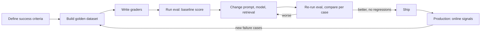

You changed the tutor's system prompt, tried three questions, and the answers looked better. Did
the change make the feature better? For which questions? Did it break anything? Without
**evals** (systematic evaluations), nobody can say, and every model upgrade, prompt tweak and
retrieval change becomes a gamble. Sessions 9.2.3 and 9.3.5 evaluated prompts and RAG; this
session generalises to any LLM feature and to the full lifecycle, offline and in production.
References: [Hugging Face Evaluate](https://huggingface.co/docs/evaluate/index), the
[Anthropic courses](https://github.com/anthropics/courses) (which include a prompt evaluations
course) and the [OpenAI Cookbook](https://developers.openai.com/cookbook) (many eval recipes).

## Why evals: vibes don't scale

"Vibe checking" (trying a few inputs by hand and judging by feel) is how everyone starts, and it is
fine for the first hour. It fails because:

- **You test what you remember**, usually the easy cases. Real users send the weird ones.
- **LLM output varies.** One good answer doesn't mean the next ten are good.
- **Changes have side effects.** Making answers shorter may fix verbosity and break code examples.
- **Nobody else can check your vibes.** A team needs a shared, repeatable definition of "good".
- **You can't compare.** Is the new model worth twice the price? Only numbers on the same test set
  answer that.

Evals are to LLM features what tests are to code, with one difference: outputs are rarely exactly
right or wrong, so evals often produce **scores and rates** rather than pass/fail.

> [!EXAMPLE]
> A team upgrades to a newer, better model. Their vibe check is enthusiastic. Their eval shows
> overall quality up, but a 15% drop on "answer must include a code example" because the new model
> prefers prose. One line in the prompt fixes it, before users notice.

The eval-driven loop looks like test-driven development:



## Golden datasets and graders (code, human, LLM-as-judge)

A **golden dataset** is a curated set of inputs with what a good output must have. Each case:

```json
{
  "id": "tutor-017",
  "session_id": "3.2.1",
  "question": "Why would an index make my inserts slower?",
  "must": ["explains that each index must be updated on write", "concrete example"],
  "must_not": ["claims indexes have no write cost"],
  "tags": ["concept", "databases"]
}
```

Build it from real usage, hand-written edge cases, every bug report, and (reviewed) synthetic
cases. Tag cases by type so you can see where quality changes, not just the average.

**Graders** score outputs. Three families, in order of preference:

**Code-based graders**: deterministic checks. Exact match, regex, JSON schema validity, length
limits, "contains a citation", "code block parses", "calls the right tool". Fast, free and
reliable. [Hugging Face Evaluate](https://huggingface.co/docs/evaluate/index) packages common metric
implementations (`exact_match`, `accuracy`, `f1`, `rouge`, `bertscore`) behind one interface:

```python
import evaluate
exact = evaluate.load("exact_match")
print(exact.compute(predictions=["billing", "bug"], references=["billing", "other"]))
# {'exact_match': 0.5}
```

**Human graders**: people rating outputs against a rubric. The gold standard for nuance (tone,
helpfulness, pedagogy), but slow and expensive. Use them to build and **calibrate** the dataset and
other graders, and for periodic spot checks.

**LLM-as-judge**: a model grades outputs against a rubric. Flexible enough for "is this explanation
correct and suitable for a junior developer?", cheap compared with humans, but it is a model with
its own biases:

```text
You are grading a tutor's answer for a junior developer.

<question>{{QUESTION}}</question>
<answer>{{ANSWER}}</answer>
<criteria>
1. Technically correct.
2. Explains that each index must be updated on every write.
3. Includes a concrete example.
4. Under 250 words, no jargon left unexplained.
</criteria>

For each criterion, reason briefly in <reasoning>, then output <scores> as JSON:
{"correct": 0|1, "write_cost": 0|1, "example": 0|1, "accessible": 0|1}
```

Making judges trustworthy:

- **Specific, binary criteria** beat "rate quality 1-10". Several yes/no checks are more consistent
  than one vague score.
- **Reason before scoring**, and parse a structured result.
- **Validate the judge against humans**: grade 30-50 outputs by hand, run the judge on them, and
  measure agreement. If it disagrees often, fix the rubric before trusting it.
- **Watch known biases**: judges tend to favour longer answers, the first option in pairwise
  comparisons, and outputs from their own model family. Randomise order in pairwise comparisons and
  control for length.
- Use a **strong model** as judge and keep it fixed while comparing versions.

> [!TIP]
> Pairwise comparison ("which of A and B better meets the criteria?") is often more reliable than
> absolute scores when comparing two prompt versions. Run both orders and only count consistent
> verdicts.

## Offline vs online evaluation

**Offline evaluation** runs before release, on your golden dataset, in development or CI. It
catches regressions and lets you compare options cheaply and safely. Its blind spot: it only knows
the cases you wrote.

**Online evaluation** measures the live system with real users:

- **Explicit feedback**: thumbs up/down, "was this helpful?", reports. Sparse and biased (unhappy
  users click more) but direct.
- **Implicit signals**: did the user accept the suggestion, edit it heavily, retry the question,
  copy the code, abandon the session, open a support ticket?
- **Sampled LLM-judge scoring** of production traffic (with privacy safeguards) to track quality
  over time.
- **A/B tests** for changes that offline evals can't settle (session 9.2.3).
- **Operational metrics**: latency, error rate, cost per request (session 9.6.2).

| | Offline | Online |
| --- | --- | --- |
| When | before shipping, every change | continuously after shipping |
| Data | golden dataset | real traffic |
| Strength | controlled, comparable, safe | real behaviour, finds unknown failures |
| Weakness | only knows what you thought of | noisy, slow, needs traffic, privacy work |

The two feed each other: online failures become new offline cases, and offline evals gate what
reaches users.

> [!WARNING]
> Production data used for evaluation is still personal data. Anonymise or get consent before
> copying real conversations into a dataset, and keep eval datasets out of public repositories if
> they contain anything sensitive.

## Practice: an eval suite for your tutor feature

Build an offline eval suite for YouCanDoIt's tutor endpoint (`POST /ai/tutor`). About three hours.

### Step 1: Write the golden dataset

Create `evals/tutor.jsonl` with 30 cases across at least five sessions from different tracks. Mix
concept questions, "show me code" questions, follow-ups with `history`, an off-topic question, a
question whose answer isn't in the session's sources, and a prompt-injection attempt. For each, list
`must` and `must_not` criteria.

### Step 2: Call the real endpoint

With the stack running (`docker compose up -d`), write `evals/run_tutor.py` that posts each case
to `http://localhost:8000/ai/tutor` with `session_id`, `question` and `history`, and saves the
`answer` and `citations` to `evals/out/<run-id>.jsonl`. Record which LLM provider answered
(`GET /ai/status`).

### Step 3: Code graders

Implement deterministic checks: answer under 300 words, at least one `[n]` citation when the
session has indexed sources, every cited number exists in `citations`, no raw system-prompt text
leaked, a code block present when the question asks for code.

### Step 4: LLM judge, calibrated

Write a judge prompt that checks each case's `must` and `must_not` criteria as binary scores. Grade
15 outputs yourself first, run the judge on the same 15, and compute agreement. Improve the rubric
until agreement is high, then judge the full set.

### Step 5: Compare two variants

Change one thing (the tutor system prompt in `apps/api/app/routes/ai.py` on a branch, or the model
via `LLM_PROVIDER`/model settings), re-run, and print a per-case comparison with improvements and
regressions by tag. Write a short `evals/README.md` explaining how to run the suite, so the next
change to the tutor starts with a baseline.
