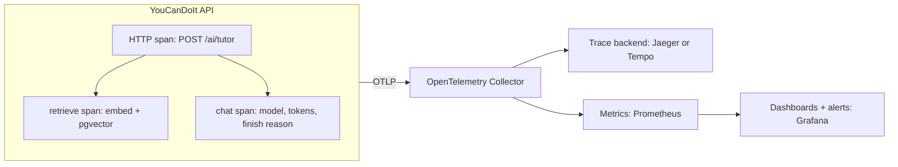

Once an LLM feature is live, three questions come up every week: *Why did it answer that?*, *Why
was it slow?* and *Why is the bill so high?* Normal application monitoring (HTTP status codes, CPU,
request latency) can't answer them, because the interesting part happens inside the prompt, the
retrieval step and the model call. **LLM observability** adds that visibility: traces of every
call with model, tokens, latency and outcome, and dashboards that turn those into cost and quality
trends. References: the [OpenTelemetry docs](https://opentelemetry.io/docs/) and the
[Claude Developer Platform docs](https://platform.claude.com/docs/en/home) (usage fields, pricing
and the Console's usage reporting).



## What to log (and what not to)

Log enough to **debug, attribute cost and measure quality**, and no more.

**Always record, for every LLM call:**

| Field | Why |
| --- | --- |
| Feature / endpoint name | cost and quality per feature |
| Provider and exact model ID | compare models, catch silent changes |
| Prompt template id and version | link outputs to the prompt that produced them (9.2.3) |
| Input, output and cached tokens | cost, cache effectiveness |
| Latency: total and time to first token | user experience |
| Stop / finish reason | truncation (`max_tokens`), tool use, refusals |
| Outcome: success, error type, retries, fallback used | reliability |
| Trace and request IDs; anonymised user or tenant ID | join with other logs, per-user budgets |
| Retrieval details: number of chunks, document IDs, scores | debug RAG answers |

**Be careful with content** (prompts, documents, answers). It is the most useful data for
debugging and the most dangerous to store:

- It contains **personal data** users typed, and documents they uploaded.
- It may contain **secrets** pasted by users or fetched by tools.
- It can be large, so storage costs add up.

Sensible defaults:

- **Metadata always, content by policy.** Store full content only where needed, for a limited
  time, with restricted access. Many teams sample (for example 1-5% of conversations) or capture
  content only for flagged or failed requests.
- **Redact before export**: emails, phone numbers, card numbers, API keys and tokens. Do it in the
  application or in the telemetry collector, never only in the dashboard.
- **Respect user choices and the law**: deletion requests must reach logs and traces too, and
  retention must be defined (session 6.5.1).
- **Never log credentials**: provider API keys, auth headers, cookies.

> [!WARNING]
> "Log the full request for debugging" in an LLM app means logging every user's private
> conversation into a system that far more engineers can read than your database. Decide
> deliberately, write it down, and enforce it in code.

## Tracing LLM calls with OpenTelemetry

[OpenTelemetry](https://opentelemetry.io/docs/) (OTel) is the vendor-neutral standard for
**traces**, **metrics** and **logs**. A trace is one request's journey; it is made of **spans**,
each a timed operation with attributes, nested in a tree. The same instrumentation can be sent to
any backend (Jaeger, Grafana Tempo, Honeycomb, Datadog, LLM-specific tools) by changing exporter
configuration, not code.

Setting up the Python SDK with an OTLP exporter:

```python
from opentelemetry import trace
from opentelemetry.exporter.otlp.proto.grpc.trace_exporter import OTLPSpanExporter
from opentelemetry.sdk.resources import Resource
from opentelemetry.sdk.trace import TracerProvider
from opentelemetry.sdk.trace.export import BatchSpanProcessor

provider = TracerProvider(resource=Resource.create({"service.name": "ycdi-api"}))
provider.add_span_processor(BatchSpanProcessor(OTLPSpanExporter(endpoint="http://otel:4317", insecure=True)))
trace.set_tracer_provider(provider)
tracer = trace.get_tracer("ycdi.llm")
```

Auto-instrumentation libraries add spans for FastAPI requests, `httpx` calls and SQLAlchemy queries
with little code (`opentelemetry-instrumentation-fastapi` and friends). For the LLM call itself,
wrap it in a span and set attributes. OpenTelemetry's **generative AI semantic conventions** define
standard names with a `gen_ai.` prefix, such as the operation name, the requested model and the
input and output token usage, so any tool can understand your spans. The conventions are still
evolving; check the current names in the OpenTelemetry docs before you standardise on them.

```python
async def chat(self, system, messages, json_mode=False):
    with tracer.start_as_current_span(f"chat {self.model}") as span:
        span.set_attribute("gen_ai.operation.name", "chat")
        span.set_attribute("gen_ai.request.model", self.model)
        span.set_attribute("app.feature", current_feature.get())
        try:
            msg = await self.client.messages.create(
                model=self.model, max_tokens=1500, system=system, messages=messages)
        except Exception as e:
            span.record_exception(e)
            span.set_status(trace.Status(trace.StatusCode.ERROR))
            raise
        span.set_attribute("gen_ai.usage.input_tokens", msg.usage.input_tokens)
        span.set_attribute("gen_ai.usage.output_tokens", msg.usage.output_tokens)
        span.set_attribute("gen_ai.response.finish_reasons", [msg.stop_reason])
        return "".join(b.text for b in msg.content if b.type == "text")
```

Because the span is created inside the request's span, the trace for `POST /ai/tutor` shows the
whole story: HTTP request, embedding call, pgvector query, LLM call, with timings for each. When a
user says "the tutor took 20 seconds", you open the trace and see whether retrieval or the model
was slow.

> [!TIP]
> Put a **trace ID** in your API's error responses and logs. A user report with a trace ID turns
> an hour of guessing into a two-minute lookup.

## Cost and token dashboards

Providers bill per token, so cost is a metric you compute, not something you discover at the end of
the month. Ingredients:

1. **Token counts per call** from the response `usage` (input, output, cache reads and writes).
2. **A price table** per model in your config (prices change; keep them in one place and date
   them). Remember the discounts: cached input and batch requests are much cheaper (session 9.1.2).
3. **Metrics**: counters for tokens and cost labelled by `feature`, `model` and `provider`, and a
   latency histogram. Export them via OTel metrics or compute them from stored call records.

```python
from opentelemetry import metrics
meter = metrics.get_meter("ycdi.llm")
tokens = meter.create_counter("llm.tokens", unit="{token}")
cost = meter.create_counter("llm.cost", unit="USD")
latency = meter.create_histogram("llm.duration", unit="s")

labels = {"feature": feature, "model": model}
tokens.add(u.input_tokens, {**labels, "type": "input"})
tokens.add(u.output_tokens, {**labels, "type": "output"})
cost.add(price_in[model] * u.input_tokens / 1e6 + price_out[model] * u.output_tokens / 1e6, labels)
latency.record(elapsed, labels)
```

Dashboard panels worth having:

| Panel | Question it answers |
| --- | --- |
| Cost per day by feature | which feature drives the bill? |
| Cost per request (p50, p95) by feature | are some requests unexpectedly expensive? |
| Tokens per request, input vs output | is context growing (history, retrieval)? |
| Cache hit ratio | is prompt caching working? |
| Latency p50/p95 and time to first token | how does it feel to users? |
| Error and fallback rate by provider | is a provider degrading? |
| Finish reason = max_tokens rate | are answers being cut off? |

Then add **alerts**: daily spend above budget, cost per request doubling, error rate spikes, p95
latency above your target. Cross-check your computed cost against the provider's own usage
reporting in its console once a month; differences reveal untracked calls.

## Practice: add LLM tracing to YouCanDoIt

Instrument the YouCanDoIt API so every tutor and "ask" request produces a trace and cost metrics.
Work on a branch. About three hours.

### Step 1: Run a local telemetry stack

Add Jaeger (all-in-one, OTLP enabled) to a local `docker-compose.override.yml` and point the API at
it with the standard environment variable `OTEL_EXPORTER_OTLP_ENDPOINT`.

### Step 2: Set up the SDK

Add `opentelemetry-sdk`, `opentelemetry-exporter-otlp`,
`opentelemetry-instrumentation-fastapi` and `opentelemetry-instrumentation-httpx`. Configure the
tracer provider in the app's startup (in `apps/api/app/main.py`'s lifespan) and instrument the
FastAPI app. Keep it disabled in tests, the same way the scheduler is disabled with
`SCHEDULER_ENABLED=false`.

### Step 3: Instrument the LLM layer

In `apps/api/app/llm.py`, wrap `chat` and `embed` in each provider with spans carrying model, token
counts (Anthropic returns `usage`; Ollama's response includes token counts too) and errors. In
`apps/api/app/rag.py`, add a span around `retrieve` with `k`, filters and the number of hits. Do
not record prompt or answer text.

### Step 4: Cost metrics

Add a small price table to settings and record token and cost counters labelled by feature
(`tutor`, `ask`, `summary`) and model. Local Ollama models cost zero in money but not in latency;
keep both visible.

### Step 5: Investigate a real request

Ask the tutor three questions, open Jaeger, and find the slowest span in each trace. Write two or
three sentences on what dominates latency in YouCanDoIt (embedding, the database or the model) and
one change you'd make first.
