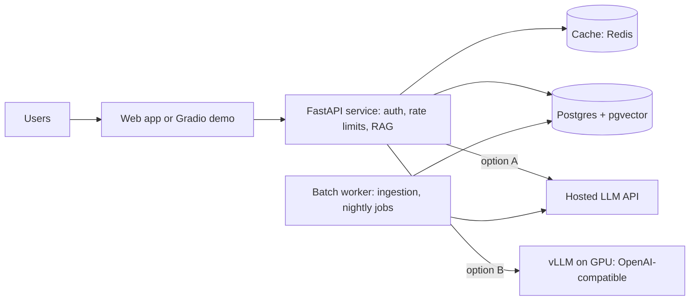

You have a RAG chatbot that works on your laptop. Deploying it means answering new questions: how do
users reach it (an API, a UI, a nightly job)? Where does the model run (a provider's API, or your
own GPU)? What happens when fifty people use it at once? This session covers the serving patterns,
a fast way to ship a demo UI, what self-hosting a model involves, and how to scale and cache.
References: the [FastAPI docs](https://fastapi.tiangolo.com/), the
[Gradio guides](https://www.gradio.app/guides) and the [vLLM docs](https://docs.vllm.ai/en/latest/).



## Serving patterns: API, batch, streaming

Three ways to deliver model output, usually combined in one product:

**Request/response API**: the client sends a request and waits for the full answer. Simple to build,
cache and test. Fine for short outputs (classification, extraction, short answers). YouCanDoIt's
`POST /ai/tutor` works this way.

**Streaming**: tokens are sent as they are generated, over server-sent events (session 9.1.5).
Essential for chat UIs, where the time to first token matters more than total time. Costs a bit more
complexity in error handling and in proxies.

**Batch**: work runs asynchronously in the background on many items: embedding a document
collection, summarising every new article overnight, running evals. Uses queues and workers, can use
the cheaper provider batch APIs, and must be idempotent and resumable.

| Pattern | User waits? | Typical use | Key concerns |
| --- | --- | --- | --- |
| API | yes, for the full answer | short structured outputs | timeouts, caching |
| Streaming | sees partial output | chat, long answers | proxies, mid-stream errors |
| Batch | no | ingestion, digests, evals | idempotency, retries, cost |

FastAPI handles all three well: `async` endpoints for API calls (so a slow model call doesn't block
the worker), `StreamingResponse` for streaming, and background tasks or a separate worker process
for batch. Long-running batch work belongs in a proper worker (a queue such as Redis plus a worker
library, or a scheduler like YouCanDoIt's APScheduler jobs), not in a request handler.

> [!TIP]
> Put LLM calls behind your own API even for internal tools. It is where authentication, per-user
> rate limits, budget checks, logging and provider fallbacks live (sessions 9.1.5 and 9.6.2). Never
> ship a provider API key to a browser.

## Gradio demos and Hugging Face Spaces

Building a full React front-end for a prototype is slow. [Gradio](https://www.gradio.app/guides) is a
Python library that builds a web UI for a function in a few lines, including a ready-made chat
interface. It is ideal for demos, internal tools and getting feedback before investing in a
production UI.

```python
import gradio as gr
import httpx

def respond(message, history):
    r = httpx.post("http://localhost:8001/ask", json={"question": message}, timeout=60)
    data = r.json()
    sources = "\n".join(f"[{c['n']}] {c['title']}" for c in data["citations"])
    return f"{data['answer']}\n\n{sources}"

gr.ChatInterface(respond, title="Ask my documents").launch()
```

Gradio functions can also be generators (`yield` partial text) to stream answers into the UI.

**Hugging Face Spaces** hosts Gradio (and other) apps from a git repository: push your `app.py`
and `requirements.txt`, and Spaces builds and serves it with a public URL. Free CPU hardware is
enough for a demo that calls a hosted API; GPU hardware is available for running models in the
Space itself. Store API keys as Space **secrets**, never in the repository.

> [!WARNING]
> A public demo that calls a paid LLM API is a public credit card. Add authentication or at least
> rate limits and a hard spending cap at the provider before sharing the link, and don't expose a
> demo connected to private documents.

## Model servers (vLLM) and GPUs

Using a hosted API is the default: no hardware, the strongest models, pay per token. You self-host
a model when you need data to stay on your infrastructure, very high volume makes per-token pricing
expensive, you need a fine-tuned open model, or you need offline operation.

Running an LLM efficiently is harder than loading it in a Python script. A **model server** handles
the hard parts. [vLLM](https://docs.vllm.ai/en/latest/) is a popular open-source one:

- **PagedAttention**: manages the attention key-value cache in pages, like virtual memory, to waste
  far less GPU memory.
- **Continuous batching**: new requests join the running batch as soon as there is space, instead
  of waiting for the whole batch to finish. This is the main reason throughput is much higher than
  naive serving.
- **An OpenAI-compatible HTTP server**, so existing client code works by changing the base URL.
- Support for quantised models, tensor parallelism across several GPUs, and many model families.

```sh
pip install vllm
vllm serve Qwen/Qwen2.5-7B-Instruct --max-model-len 8192
# then, from your app:
#   OpenAI(base_url="http://gpu-box:8000/v1", api_key="unused").chat.completions.create(...)
```

**GPU sizing** starts with memory. Model weights need roughly *parameters x bytes per parameter*:
a 7-billion-parameter model in 16-bit precision needs about 14 GB for weights alone, plus memory for
the KV cache, which grows with context length and the number of concurrent requests. Quantisation
(8-bit or 4-bit) cuts weight memory substantially at some quality cost.

| | Hosted API | Self-hosted (vLLM) |
| --- | --- | --- |
| Setup | an API key | GPUs, drivers, server, monitoring |
| Cost model | per token | per GPU hour, used or not |
| Best models | yes | open-weight only |
| Data control | provider's terms | yours |
| Scaling | provider's problem (within rate limits) | yours |

> [!NOTE]
> For local development, Ollama (which YouCanDoIt uses) is the easy option: it runs quantised models
> on a laptop CPU or GPU. vLLM targets production throughput on server GPUs. Both expose APIs your
> code can call the same way.

## Scaling and caching strategies

**Scale the API layer horizontally.** Your FastAPI service should be stateless (conversation state
in the database, not in memory) so you can run several replicas behind a load balancer. LLM calls are
I/O-bound waits, so async workers handle many concurrent requests each.

**Respect the model's limits.** With a hosted API, provider rate limits are the ceiling: queue and
smooth bursts, and prioritise interactive traffic over batch. With self-hosting, GPU throughput is
the ceiling: scale replicas of the model server, and watch queue depth and time to first token as
your scaling signals, not CPU.

**Cache at every level** (session 9.1.5):

- **Embeddings**: never re-embed unchanged text (YouCanDoIt skips pages whose content hash hasn't
  changed). Cache query embeddings for repeated questions.
- **Retrieval results** for popular queries, for a short time.
- **Full responses** for deterministic, repeated requests (a summary of article 42).
- **Provider prompt caching** for long, stable prefixes.
- **Static demo answers** for the example questions shown on your landing page.

**Degrade gracefully.** When the model is slow or unavailable: shorter answers, a smaller model, a
cached answer, or a clear "try again" message, rather than a spinner that never ends.

## Practice: deploy your RAG app with a demo UI

Deploy the document chatbot from 9.3.3 as an API plus a Gradio UI. About three hours.

### Step 1: Containerise the API

Write a `Dockerfile` for your FastAPI RAG service (Python slim base, install dependencies, run with
`uvicorn`). Configuration comes from environment variables: database URL, LLM provider and key,
embedding endpoint. Add a `/health` endpoint.

### Step 2: Compose the stack

Create a `docker-compose.yml` with Postgres plus pgvector, your API and the Gradio UI. Run ingestion
as a one-off command (`docker compose run --rm api python ingest.py`).

### Step 3: Build the Gradio UI

Use `gr.ChatInterface` calling your API, with streaming if your API supports it, the citations
under each answer, and three example questions. Add a password with `launch(auth=...)` for anything
beyond localhost.

### Step 4: Add protection and caching

Add a per-IP rate limit and a daily budget check in the API, and a response cache keyed on the
normalised question plus the index version. Measure the latency of a repeated question with and
without the cache.

### Step 5: Publish a demo

Either deploy to Hugging Face Spaces (UI calling a hosted API, keys as Space secrets, using a public
sample document set) or to a small VM with the compose file. Share the link with one person, watch
your logs and cost dashboard while they use it, and write down the first three things that
surprised you.
