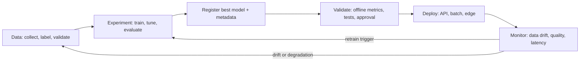

Training a model in a notebook is the easy 10%. The other 90% is everything around it: knowing which
data and settings produced which model, reproducing a result from three months ago, deciding which
version goes to production, noticing when it quietly gets worse because the world changed. That is
**MLOps**: applying DevOps discipline (versioning, automation, testing, monitoring) to machine
learning, where the "code" includes data and trained weights. References:
[ml-ops.org](https://ml-ops.org/) for principles and the [MLflow docs](https://mlflow.org/docs/latest/)
for the tool you'll use.

Analogy: a restaurant kitchen. A great dish once is a recipe experiment. A restaurant needs written
recipes with exact quantities (experiment tracking), a record of which supplier's ingredients went
into which batch (data versioning), a head chef approving dishes before they go on the menu (model
registry), and tasting the food every service because ingredients change (monitoring).

## The ML lifecycle in production

An ML system has three things that change, not one: **data**, **model** and **code**. A bug can
come from any of them, and reproducing a result needs all three versions. ml-ops.org frames MLOps
around exactly this: versioning, testing, automation and monitoring applied to data, model and code
together.



The stages:

1. **Data**: collect, clean, label, split; validate schemas and distributions; version the dataset.
2. **Experimentation**: train candidates with different features, models and hyperparameters;
   track every run.
3. **Packaging and registration**: save the chosen model with its environment, signature (input and
   output schema) and lineage (data version, code commit, metrics).
4. **Validation and release**: automated checks plus human approval, then deployment (session
   9.6.3), often gradually or in shadow mode.
5. **Monitoring**: watch inputs, outputs and real outcomes; trigger retraining or rollback.

Maturity is often described in levels: from **manual** (notebooks, models handed over by hand),
through **automated training pipelines** (retraining runs as a pipeline, continuous training),
to **automated CI/CD of the pipelines themselves**. Most teams don't need the top level; they need
reproducibility and monitoring first.

> [!NOTE]
> For LLM applications built on hosted models, you don't train the model, but the same lifecycle
> applies to prompts, retrieval indexes and fine-tuned adapters: version them, evaluate them
> (session 9.6.1), release them carefully and monitor them (session 9.6.2). Some call this LLMOps.

## Experiment tracking and model registry (MLflow)

**Experiment tracking** records, for every training run: parameters, metrics (over time), the code
version, the data version, and output **artifacts** (model files, plots, confusion matrices). Without
it you end up with `model_final_v3_REALLY_final.pt` and no idea how it was made.

[MLflow](https://mlflow.org/docs/latest/) is an open-source platform for this. Its tracking API:

```python
import mlflow

mlflow.set_tracking_uri("http://localhost:5000")
mlflow.set_experiment("ticket-classifier")

with mlflow.start_run(run_name="distilbert-lr3e-5"):
    mlflow.log_params({"base_model": "distilbert-base-uncased", "lr": 3e-5, "epochs": 3,
                       "data_version": "tickets-2026-05-01"})
    for epoch in range(3):
        loss = train_one_epoch()
        mlflow.log_metric("train_loss", loss, step=epoch)
    mlflow.log_metric("val_f1", evaluate_f1())
    mlflow.log_artifact("confusion_matrix.png")
```

Many libraries integrate directly: MLflow's **autologging** (`mlflow.autolog()`) captures
parameters and metrics for supported frameworks, and Hugging Face's `Trainer` can report to MLflow
through its `report_to` setting. The MLflow UI then lets you sort and compare runs, plot metrics
side by side and find the best one.

The **model registry** is the catalogue of models that are candidates for, or in, production. From
the MLflow docs:

- A **registered model** is a named entry (for example `ticket-classifier`).
- Each registration adds a numbered **version**, linked back to the run that produced it, so you
  have lineage from production model to code, data and metrics.
- **Aliases** are movable pointers to a version, such as `champion` for what production should use.
  Promoting a model is moving the alias; rolling back is moving it back.
- **Tags** and descriptions record validation status and notes.

```python
# register at logging time
mlflow.transformers.log_model(pipeline, name="model", registered_model_name="ticket-classifier")

# later: point production at version 4, and load by alias in the serving code
from mlflow import MlflowClient
MlflowClient().set_registered_model_alias("ticket-classifier", "champion", 4)
model = mlflow.pyfunc.load_model("models:/ticket-classifier@champion")
```

> [!TIP]
> Make the serving code load `@champion`, never a hard-coded version or file path. Then
> deployment and rollback are registry operations, auditable and reversible, instead of code
> changes.

## Data and model drift monitoring

A model is trained on a snapshot of the world, and the world keeps moving. **Drift** is the general
name for the mismatch that grows over time:

- **Data drift (covariate shift)**: the input distribution changes. New product categories appear,
  users start writing tickets in Spanish, a sensor is recalibrated.
- **Concept drift**: the relationship between inputs and the correct output changes. "Urgent" used
  to mean "outage" and now also means "billing error before month end"; fraud patterns adapt to your
  detector.
- **Prediction drift**: the distribution of the model's outputs changes (suddenly 40% of tickets
  are "billing" instead of 15%), often the first visible symptom of either of the above.

How to detect it:

| What to monitor | How | Needs labels? |
| --- | --- | --- |
| Input feature distributions | compare recent window vs training data: statistical tests (Kolmogorov-Smirnov for numbers, chi-squared for categories), Population Stability Index | no |
| Embedding distributions (text, images) | distance between mean embeddings, share of inputs far from training data | no |
| Prediction distribution, confidence | class proportions, average confidence over time | no |
| Data quality | missing values, schema violations, out-of-range values | no |
| Actual performance | accuracy, F1, error rates on labelled samples | yes, often delayed |

Ground-truth labels often arrive late (did the customer churn? was it fraud?), so label-free drift
signals act as early warnings, and performance on delayed labels confirms them.

```python
from scipy.stats import ks_2samp

stat, p = ks_2samp(training_df["ticket_length"], last_week_df["ticket_length"])
if p < 0.01:
    alert("ticket_length distribution has shifted", statistic=stat)
```

> [!WARNING]
> With large samples, statistical tests flag tiny, harmless differences as "significant". Look at
> effect size and business impact, not just p-values, and set thresholds from historical data so
> alerts are rare and meaningful.

When drift is confirmed: investigate the cause (a bug upstream is common), collect and label new
data, retrain, evaluate against the current champion on recent data, and promote through the
registry if it is better.

## Practice: track your fine-tuning runs with MLflow

Use MLflow to track the fine-tuning experiments from Track 8 (or a small text classifier
fine-tuned with Hugging Face `transformers`). About two to three hours.

### Step 1: Start an MLflow server

```sh
pip install mlflow
mlflow server --host 127.0.0.1 --port 5000
```

Open `http://127.0.0.1:5000`. (Or run it in Docker next to your other services.)

### Step 2: Instrument training

Set the tracking URI and experiment name, then run training with logging enabled (via
`mlflow.autolog()` or the Trainer's MLflow reporting, plus explicit `log_params` for things autolog
doesn't know): base model, dataset name and version (a hash of the training file is enough), git
commit, learning rate, epochs, batch size.

### Step 3: Run a small sweep

Run at least four configurations (two learning rates x two epoch counts, or two base models). Log
validation metrics and a confusion matrix artifact for each. Compare them in the UI and pick the best
by your validation metric.

### Step 4: Register and promote

Register the best run's model as `my-classifier`, set alias `champion`, and write a tiny script
that loads `models:/my-classifier@champion` and predicts on three examples. Then register a second
version, move the alias, and confirm the script now uses it without code changes.

### Step 5: Simulate drift

Create a "production" sample whose distribution differs (longer texts, a new category, another
language). Compute a KS test on text length and the change in predicted class proportions versus the
validation set, and log both as metrics in a new "monitoring" run. Write two sentences on what you
would do next if this were real traffic.
