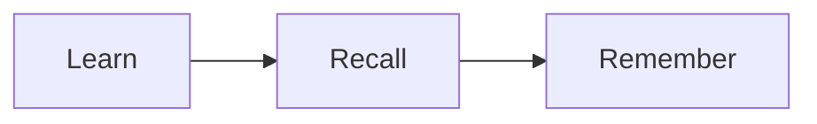

# Lesson format

One file per session: `content/lessons/<session id>.md` (e.g. `0.1.1.md`). The API returns it as
`SessionDetail.lesson`, the web renders it on the session page, and `index-sources` indexes it
into RAG. `apps/api/tests/test_lessons.py` enforces the rules below.

## Rules

- **No H1.** The title comes from `ROADMAP.md`.
- **One `## ` heading per subchapter bullet**, same text and same order as in `ROADMAP.md`
  (the `Practice:` bullet too). Use `###` for anything below that.
- **Mermaid blocks must not be empty.** They must also parse: put edge labels with `.`, `--` or `/` in
  `-->|"quotes"|`, and never use Mermaid keywords (`loop`, `call`, `end`, …) as ids or task names.
  A diagram that fails to parse shows its source instead.
- 1,200–2,500 words (guideline, not tested). Audience: a junior developer without a CS degree aiming at a senior role —
  analogies first, then the precise term, then a concrete example.
- Link the session's sources from `ROADMAP.md` where they back a claim. Don't invent URLs.
- The heading is the bullet text without its `{#N}` key. Never rename `ROADMAP.md` bullets to fit a lesson.

## Blocks

Callouts (colour-coded): a blockquote whose first line is a marker.

```md
> [!NOTE]
> Background or definition.

> [!TIP]
> A practical shortcut.

> [!WARNING]
> A common mistake.

> [!EXAMPLE]
> A worked example.
```

Diagrams:

````md

````

Normal fenced code (```` ```python ````, ```` ```sh ````…) and GFM tables are fine.
